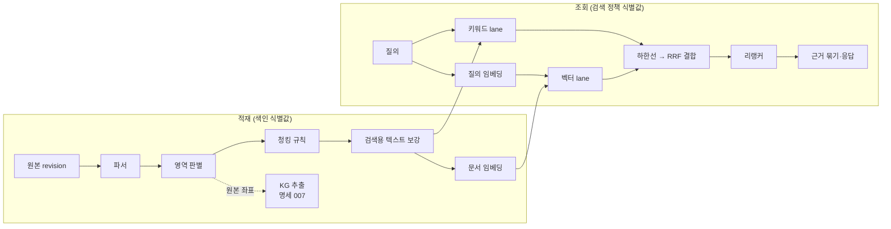
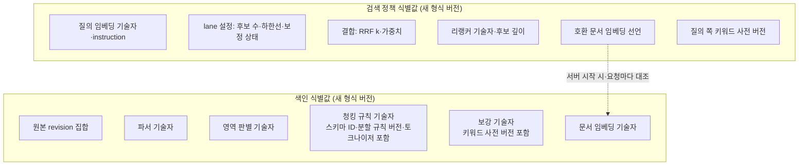

# 공통 모듈 구조 설계서 — 교체 가능한 색인·검색 모듈과 식별값 배치

- 상태: 승인 — 2026-11-09 사용자 승인(D-01~D-11 권장안, 기존 데이터 보존 불필요)
- 작성일: 2026-11-09
- 버전: v0.3
- 변경 요약(v0.3): 사용자 결정 반영 — D-01~D-11 권장안 승인, 기존 데이터 보존 불필요(새 형식 적용 시 재색인·재등록, 레거시 호환 코드 없음, 전환 후 MVP 색인으로 되돌리기 불가)로 D-01과 모든 마이그레이션 줄 갱신; 평가 적중 입력의 자료 식별·다중 경로 처리, 평가 자원 분리, D-11과 공개 정책 관리 금지의 관계, legacy 함수 제거, 임베딩 되돌리기 시 GPU 메모리 주의 추가.
- 검증 반영(v0.3): 평가 환경의 DB 분리·운영 적용 절차를 승인 내용에서 빼 O-13(제안·미승인)으로 이동, 15절 적용 단계에 O-13 참조·운영 하드웨어 하한선 재확인·smoke 단계 추가, 산출물 동일성 대조 범위(청크 해시, 벡터는 O-8 전 보장 없음) 명시, `AGENTS.md` MVP 서술과의 범위 구분, 감사 컬럼 NOT NULL과 기존 행 처리의 묶임 명시; 적용 전 확인을 값 변경 없는 재확인으로 한정(재보정은 새 후보로 관문 재평가·재승인), 임베딩 교체의 하한선 보정을 관문 이전 단계로 이동.
- 추가 반영(2026-11-13, v0.3 유지(사용자 결정 2026-11-13)): 사용자 결정 2026-11-13 반영 — 9.1 연구 실행 자원, 9.3 D-05, 15절 머리말, 18절 D-04·D-05 권장안, 20절 O-13 행의 "분리 자원" 문구에 `002` FR-033 "운영 개시 전 예외"(사용자가 운영 개시를 알리기 전까지 운영 서버를 연구 자원으로 사용 가능) 참조 추가. 결정 D-01~D-11의 내용은 바뀌지 않았다.
- 이전 변경 요약(v0.2): 연구 명세 번호 정정(`012` 리랭커·`013` 파싱·영역 판별·청킹·`014` 임베딩), `002` 최신본(겹침 적중·반환 근거 평균 길이·트랙별 시도 한도) 정합, 정책–색인 대조 시점과 전환·되돌리기 순서 정정, 되돌리기 준비 검사 영향과 결정별 마이그레이션 영향 추가, `AGENTS.md` MVP 결정과의 관계 절 추가.
- 작성자: Claude Code(사용자 JG.Kim 지시로 작성)
- 열람 대상: 플랫폼 개발자·검색 품질 연구자
- 정본 형식: 이 Markdown 파일이 정본이다. 열람용 HTML은 이 파일에서 따로 만들며 HTML을 직접 고치지 않는다.
- 문서 규칙 예외: `crefle-doc` 예외로 Markdown 정본을 쓴다(사용자 승인 2026-11-09, `AGENTS.md` 반영 예정).

## 용어표

이 문서만 읽고 이해할 수 있도록 약어, 은어, 다른 문서에서 가져온 키워드를 여기서 모두 설명한다.

| 용어 | 뜻 |
|---|---|
| 모듈 | 색인·검색 과정에서 구현을 바꿔 끼울 수 있는 구성 요소. 이 문서는 파서, 영역 판별, 청킹 규칙, 검색용 텍스트 보강, 임베딩, 리랭커의 6종을 정한다. |
| 구현 | 한 모듈 종류의 구체적인 프로그램 하나. 예: 리랭커 모듈의 "통과" 구현, "교차 인코더 X" 구현. |
| 모듈 기술자(descriptor) | 모든 모듈 구현이 내놓는 자기 설명 묶음. 종류, 구현 이름, 버전, 설정의 정규화 해시, 모델 id·revision(있으면)으로 이루어진다(5절). 코드의 `EmbeddingDescriptor`처럼 "descriptor"라는 이름도 같은 뜻으로 쓴다. |
| snapshot | 어느 시점의 설정 값을 고정해 저장한 JSON 묶음. 예: 색인 설정의 parser·chunk·embedding snapshot, 검색 정책 snapshot. |
| 정규화 해시 | 설정을 키 순서·공백·숫자 표기가 늘 같은 JSON(canonical JSON)으로 바꾼 뒤 SHA-256으로 계산한 값. 같은 설정이면 항상 같은 해시가 나온다. 현재 코드의 `config_hash`가 이 방식이다. |
| Protocol | 구현을 바꿔 끼울 수 있게 "이런 함수를 가져야 한다"만 정한 Python 인터페이스. |
| 레지스트리 | (종류, 구현 이름, 버전)을 받아 구현을 만들어 주는 명시적 목록. 코드에 직접 적어 두며 외부에서 코드를 불러오지 않는다(14절). |
| entry point | Python 패키지가 설치 정보에 "이 이름이면 이 코드를 불러라"라고 등록해 두는 장치. 동적 플러그인 로딩에 흔히 쓴다. |
| 조립 지점 | 프로그램 시작 시 어떤 구현을 쓸지 정해 서로 연결하는 곳. 현재는 색인 명령(`interfaces/cli/indexing.py`)과 API 서버 시작(`interfaces/api/runtime.py`) 두 곳이다. |
| OMF | 이 플랫폼의 첫 조회 대상 프로젝트. 현재 색인은 OMF 설계 문서 저장소의 Markdown이다. source 이름도 `omf`다. |
| source | 검색 대상 자료 묶음 하나. 권한(source grant)과 활성 색인이 source 단위로 붙는다. |
| 파서 | 파일에서 글자·표·위치를 꺼내는 프로그램. 글자 추출을 LLM에 맡기지 않는다. |
| LLM | 대규모 언어 모델. 글을 이해하고 생성하는 AI 모델이다. 내부 LLM은 사내 모델 서버의 Kanana 생성 모델이다. |
| 영역 | 문서 안에서 성격이 같은 한 덩어리(본문, 표, 목록, 머리말, 그림 자리 등). 영역 판별은 그 경계와 종류를 정하는 일이다. |
| 청크 | 자료를 검색 단위로 나눈 조각. 청킹은 그 나누는 작업이다. |
| 청킹 규칙 | 영역을 청크로 나누는 방법. 스키마의 분할 규칙, 문서 분석 Agent가 만든 분할 규칙, 토큰 상한 같은 설정을 포함한다. 프로그램이 결정적으로 실행한다. |
| Parent–Child 분할 | 상위 절(parent)을 문맥으로 두고, 긴 절만 작은 하위 조각(child)으로 더 나눠 child로 검색하는 방식. 현재 MVP의 분할 방식이다. |
| 고아 청크 | 원본 자료의 revision·위치와 연결되지 않은 청크. 평가 하네스의 필수 검사가 0건을 요구한다. |
| 구조 경계 위반 | 분할 규칙이 보존하도록 정한 구조 단위(표의 행, 목록, 제목 절 등)를 청크 경계가 가르는 일. |
| 원문(`raw_text`) | 원본에서 꺼낸 그대로의 청크 글자. 응답 근거의 본문이며 어떤 모듈도 바꾸지 않는다. 검색 후보 안에서는 `excerpt`라는 이름으로 실린다. |
| `search_text` | 검색에만 쓰도록 원문과 따로 두는 텍스트. 키워드 lane과 문서 임베딩의 입력이다. 원문을 바꾸지 않고 만든다. |
| 검색용 텍스트 보강 | 원문을 바꾸지 않고 `search_text`를 만드는 일. 예: 제목 계층을 앞에 붙이기(제목 접두), 키워드 사전의 동의어 덧붙이기. |
| 제목 접두(anchor prefix) | 청크가 속한 제목 계층을 `search_text` 앞에 붙이는 보강. 현재 MVP가 이미 하고 있다. |
| 키워드 사전 | 용어·동의어·약어 목록. 원문은 바꾸지 않고 `search_text`와 검색 질의에만 적용한다. 명세 `003`에서 정한다. |
| 스키마, 스키마 사전 | 스키마는 DB 스키마가 아니라 자료를 해석·분할하는 규칙을 담은 등록용 정의(개념 설명, 분할 규칙, 엔티티·속성·관계 매핑)다. 스키마 사전은 등록된 스키마를 불변으로 보관하는 저장소다. 스키마 ID가 곧 불변 버전이다(명세 `001`). |
| 문서 분석 Agent | 적재 시점에 내부 LLM으로 동작하며 문서별 분할 규칙을 만들고 엔티티·속성·관계를 추출하는 Agent. 분할 규칙은 불변 버전으로 저장하고, 청킹 자체는 프로그램이 한다. |
| 임베딩 | 글을 의미 벡터(숫자 목록)로 바꾸는 일. 문서 임베딩은 청크의 `search_text`를, 질의 임베딩은 검색 질의를 바꾼다. |
| instruction | 질의 임베딩 때 질의 앞에 붙이는 지시문. 현재는 `{query}` 자리에 질의를 넣는 틀이다. |
| 리랭커 | 질의와 후보 근거를 함께 읽어 순위를 다시 매기는 모델. 채점·정렬만 하고 근거 내용을 만들거나 바꾸지 않는다. |
| 통과 모듈 | 입력 순서를 그대로 돌려주는 아무 일도 하지 않는 구현. 리랭커의 나이브 기본 구현이다. |
| 나이브 기본 구현 | 연구 결과가 적용되기 전 플랫폼이 쓰는 단순한 기본 구현. 연구 중에도 플랫폼은 이것으로 동작한다. |
| lane | 하나의 검색 경로. 현재는 키워드 lane(`pg_trgm` 글자 유사도)과 벡터 lane(`pgvector` cosine 유사도) 두 개다. |
| `pg_trgm`, `pgvector` | PostgreSQL 확장. `pg_trgm`은 3글자 조각 유사도로 키워드 검색을, `pgvector`는 벡터 저장과 유사도 계산을 맡는다. |
| `pg_search`, Korean Lindera | ParadeDB의 PostgreSQL 전문 검색 확장과 그 한국어 형태소 분석기. `AGENTS.md`가 한국어 키워드 품질 부족 시 우선 대안으로 둔 것이다. |
| ANN 인덱스 | 근사 최근접 탐색 인덱스(HNSW, IVFFlat 등). 현재는 쓰지 않고 정확 계산으로 벡터를 검색한다. |
| RRF | Reciprocal Rank Fusion. 여러 lane의 순위를 `가중치/(k+순위)`의 합으로 결합하는 방식. 현재 `k=60`, 가중치 1.0이다. |
| 하한선(floor) | lane별 원시 점수의 최소 기준. 이 값 이상인 후보만 RRF 후보가 된다. 어느 lane에도 통과 후보가 없으면 `no_evidence`다. |
| `strict` 모드 | 현재 검색 서비스의 선택 동작(`relevance_level="strict"`). RRF 결합 뒤 두 lane 모두에 나온 후보만 남긴다. 기본값은 `default`(필터 없음)다. |
| `no_evidence` | 하한선을 넘는 근거가 없을 때 검색이 돌려주는 상태 값(HTTP 200, 빈 근거 목록). |
| 503 | HTTP "서비스 사용 불가" 응답 코드. 정책·임베딩·활성 색인이 맞지 않으면 검색 API가 이 코드로 거부한다. |
| 근거 패키지 | 검색 응답. 생성 답변이 아니라 원문 인용과 재현 좌표(원본 경로, 제목 계층, 위치, 색인 run, revision, 내용 해시, 검색 순위, 검색 정책 좌표)를 담은 묶음이다. |
| revision | 한 번 정해지면 바뀌지 않는 자료 시점 식별값(불변 revision). 현재 Git 경로 자료는 commit SHA가 이 역할을 하고, 명세 `001` 이후 등록 자료는 등록 시 발급한 revision을 쓴다. |
| 위치 좌표 | revision 안에서 원문 위치를 가리키는 값. 텍스트는 행 범위, PDF는 페이지, Excel은 시트·셀 범위다. |
| 색인 run | 색인 실행 1회와 그 결과물. 상태는 `building → ready | failed`, `ready → active → previous → archived`로 바뀐다. |
| 활성 색인 | 운영 검색이 현재 쓰는 색인 run. source마다 하나이며 포인터(`source_profiles.active_index_run_id`)가 가리킨다. 공유 배포의 현재 활성 run은 `427f2c4a-ab06-486a-9801-4bde3ef17d63`(MVP 형식)이며, 새 색인 식별값 형식으로 전환할 때 재색인 대상이다. |
| 기존 데이터 보존 불필요 | 사용자 결정(2026-11-09). 기존 MVP 색인 run, 5,584개 embedding, `index_configs`, 검색 정책 manifest 2개, 감사 행 등 기존 행의 보존을 설계 제약으로 보지 않는다. 새 형식은 재색인·재등록으로 적용하고 레거시 호환 코드를 두지 않는다. |
| legacy | 현재 MVP 형식(새 형식 이전)의 저장 행·설정·코드. 이 설계는 legacy 형식을 새 형식과 함께 지원하지 않는다. |
| 무결성 매니페스트 | 임베딩 모델 파일을 사내에 미리 받아 둘 때 파일 목록과 해시를 적어 둔 기록. 서버가 오프라인에서 모델 파일이 바뀌지 않았는지 확인하는 데 쓴다(`infrastructure/embedding/manifest.py`). 검색 정책 manifest와 다른 것이다. |
| CHECK 제약 | DB가 행을 넣거나 바꿀 때 조건식을 검사해 어긋나면 거부하는 제약. 예: 감사 `status`는 `ok`·`no_evidence`만 허용. |
| trgm 인덱스 | `pg_trgm`의 3글자 조각 유사도 검색을 빠르게 하는 GIN 인덱스. 현재 `chunks.search_text`에 있다. |
| occurrence | 같은 내용이 어느 run의 어느 원본 경로에 나타났는지 기록한 행. |
| 색인 식별값(index identity) | 저장 문서·청크·벡터를 바꾸는 설정 묶음의 식별값. 현재는 `index_configs.config_hash`다. |
| 검색 정책 식별값(search policy identity) | 질의 시점 결과를 바꾸는 설정 묶음의 식별값. 불변 manifest(`search_policy_manifests`)의 `config_hash`로 식별한다. 정책 변경은 새 manifest와 API 재시작만 필요하다. |
| manifest | 한 번 넣으면 바꾸거나 지울 수 없는(append-only) 설정 기록 행. |
| 마이그레이션 | DB 구조나 저장 데이터를 바꾸는 버전 관리된 변경 스크립트(Alembic). 현재 revision은 `0003_search_policy_manifest`다. |
| 검색 구성 | (색인 run, 검색 정책)의 쌍. 평가와 적용의 단위다. 평가 하네스 명세 `002`의 "구성"과 같다. |
| provenance | 결과가 어떤 입력과 설정에서 나왔는지 보여 주는 출처 기록. 새 형식에서는 응답·실험 기록의 식별값이 이 역할을 한다. 기존 MVP 행을 provenance로 남기는 일은 하지 않는다(기존 데이터 보존 불필요). |
| 나란히 색인 | 활성 색인을 건드리지 않고 후보 구성의 색인을 별도 run으로 만들어 비교하는 방식. |
| 비공개 평가 경로 | 공개 API에 드러내지 않고 평가 실행기만 쓰는, 활성이 아닌 run에 질의하는 경로(9절). |
| 평가 하네스 | 평가셋·지표·실험 기록·적용 관문을 묶은 공용 평가 체계(명세 `002`). |
| 개발셋, 시험셋 | 개발셋은 튜닝용 평가 질의(템플릿·사내 모델 합성), 시험셋은 사람이 쓴 관문 판정 전용 평가 질의다. 시험셋 결과로 튜닝하지 않는다. |
| 적중 | 검색이 돌려준 근거의 위치가 정답 근거의 위치와 조금이라도 겹치는 것(`002` FR-011, 확정). |
| 반환 근거 평균 길이 | 검색이 돌려준 근거 원문의 평균 길이. 겹침만으로 적중을 판정하므로 긴 근거가 유리해지는지 보려고 실험마다 기록한다(`002` FR-014a). 증가 한도는 `013`이 정한다. |
| 필수 검사 | 어기면 다른 지표와 관계없이 불합격시키는 검사 5종: 결정성, 원문 커버리지, 근거 좌표 정확성, 고아 청크 0, 구조 경계 위반 0. |
| 결정성 | 같은 입력과 같은 식별값이면 항상 같은 결과가 나오는 성질. |
| 원문 커버리지 | 색인 대상 원문이 빠짐없이 어떤 청크에 담겼는지 여부. |
| 관문(적용 관문) | 후보 구성의 적용 권고 여부를 판정하는 기준. 현재 기준은 "개선 폭 기준 v1.0"(사용자 승인 2026-11-08)이며 다섯 조건을 모두 요구한다: ① 필수 검사 회귀 없음, ② 시험셋 Recall@5 +3%p 이상, ③ 짝 비교 95% 신뢰구간 하한 0 초과, ④ 의도별 하락 5%p 미만(보조 지표 하락 2%p 미만), ⑤ 비용 한도 이내(지연 p95 증가 +200ms 이하, 재색인 8시간 이하, 운영 GPU 메모리 안, 문서에 없는 질의의 `no_evidence` 비율이 낮아지지 않음). |
| 관문 시도 한도 | 같은 시험셋에서 연구 트랙(또는 트랙 밖 모듈 교체 건)마다 관문 판정 최대 3회, 한 번에 최종 후보 1개(`002` FR-025·FR-026). |
| Recall@5 | 정답 근거가 상위 5개 안에 적중한 질의의 비율. 관문의 주 지표다. |
| %p | 퍼센트포인트. 비율 사이의 차이. 60%에서 63%가 되면 +3%p다. |
| p95 | 95번째 백분위수. 질의 지연을 작은 순으로 늘어놓았을 때 95% 지점의 값이다. |
| 짝 비교, 신뢰구간 | 짝 비교는 같은 질의에 대한 두 구성의 결과를 질의 단위로 짝지어 차이를 보는 비교다. 95% 신뢰구간은 추정한 차이가 있을 법한 범위이며, 하한이 0보다 크면 개선이 우연일 가능성이 낮다고 본다. |
| 지식 그래프(KG) | 원본에서 추출한 엔티티(자료에 등장하는 개별 대상), 속성, 엔티티 간 관계를 정리한 저장소(명세 `007`). |
| 헌법 V, VII | `.specify/memory/constitution.md`(v2.1.0으로 개정 중)의 원칙. V는 근거 재현성(모든 원문 근거는 재현 좌표로 다시 찾을 수 있어야 함), VII는 조회 경로 모델은 채점·정렬만 하고 그 식별값을 검색 정책 식별값에 고정하며, 플랫폼 안 LLM 사용을 (1) 적재 시점 문서 분석 Agent, (2) 조회 경로 채점·정렬, (3) 평가·연구용 자료 생성(개발셋 질의 합성, 연구용 학습 쌍 — 생성물은 색인·응답·근거에 넣지 않음)으로 한정하고 모두 사내에서 운영하는 모델만 쓴다는 경계다. |
| 명세 번호 | Spec Kit(명세 주도 개발 도구) 명세. `001` 등록·revision, `002` 평가 하네스, `003` 파서·전처리·분할 규칙·키워드 사전, `006` RAG 적재 일반화·OMF 이관, `007` 지식 그래프, `009` 통합 조회 API, `012` 리랭커 연구, `013` 파싱·영역 판별·구조 보존 청킹 연구, `014` 임베딩 연구. |
| 연구 트랙 번호 | 원문자는 `AGENTS.md`의 연구 순서다: ① 파싱·영역 판별·구조 보존 청킹(명세 `013`), ② 리랭커(명세 `012`), ③ 임베딩(명세 `014`). **원문자 번호와 명세 번호가 엇갈리므로** 이 문서는 주로 명세 번호로 적는다. |
| RAG | 검색 기반 근거 조회. 원본 자료 내용을 검색해 근거로 돌려주는 방식이다. |
| GPU, CUDA | GPU는 모델 계산에 쓰는 그래픽 처리 장치, CUDA는 NVIDIA GPU 계산 환경이다. 공유 배포의 임베딩은 `cuda:0`에서 돈다. |
| replica | 같은 API 서버를 여러 개 띄운 사본. 현재 공유 배포는 1개다. |

## 1. 목적과 합격 기준

### 1.1 목적

검색 품질 연구 3건(명세 `012`~`014`)과 플랫폼 개발을 병렬로 진행하려면 연구 결과를 플랫폼에 "끼워 넣는" 공통 틀이 먼저 있어야 한다. 이 문서는 그 틀을 정한다.

- 교체 가능한 모듈 6종의 경계와 입력·출력
- 모듈마다 어떤 식별값(색인 또는 검색 정책)에 기록되는지
- 후보를 운영과 나란히 만들고 평가·적용·되돌리는 절차
- 각 결정의 권장안과 대안

이 문서는 사용자가 승인한 설계다(2026-11-09). 이 문서 자체는 코드, DB 스키마, 서비스 스캐폴딩을 만들지 않는다. 구현은 각 명세의 계획을 승인받은 뒤 그 계획에서 한다. 승인 범위 밖의 제안은 "제안·미승인"으로 표시한다(O-13).

### 1.2 정성적 합격 기준

연구자가 이 문서만 읽고 다음 질문에 답할 수 있으면 합격이다.

> "새 리랭커를 넣으려면 무엇을 구현하고, 어떤 식별값이 바뀌고, 어떻게 평가·적용·되돌리는가?"

- 합격 예시: 연구자가 15.1절만 읽고 "선행 조건(정책 새 형식, 시험셋 400개)이 갖춰진 뒤 리랭커 구현과 기술자를 만들고 레지스트리에 올린다. 정책 설정을 바꾸면 검색 정책 `config_hash`만 바뀌고 색인은 그대로다. 활성 run과 후보 정책 쌍을 개발셋으로 비교하고, 시험셋 관문(트랙당 3회 한도)을 통과해 승인받으면 설정을 바꿔 API를 재시작한다. 되돌릴 때는 이전 설정으로 재시작한다"라고 답한다.
- 불합격 예시: 리랭커 교체가 재색인을 요구하는지, 정책 식별값이 바뀌는지, 되돌리기에 무엇이 필요한지를 다른 문서나 코드를 찾아야 답할 수 있다.

## 2. 배경과 현재 상태

코드 근거 경로는 `src/omf_retrieval/` 기준이다.

### 2.1 이미 교체 가능한 구조

| 대상 | 현재 구조 | 근거 |
|---|---|---|
| 파서·청커·문서 임베딩·저장소 | 색인 서비스가 Protocol로 주입받는다. | `application/indexing/service.py`, `application/indexing/ports.py` |
| 임베딩 제공자 | `EmbeddingProvider` Protocol과 식별 snapshot이 있다. 구현은 sentence-transformers 하나다. | `infrastructure/embedding/provider.py`, `infrastructure/embedding/sentence_transformer.py` |
| 검색 저장소·질의 임베딩·정책 저장소 | Protocol로 주입된다. | `application/search/ports.py`, `application/search/policy.py` |
| 검색 정책 | 13개 필드 snapshot의 정규화 해시로 식별하는 불변 manifest. 서버 시작 시 등록·조회하고 요청마다 다시 대조한다. | `application/search/policy.py`, `interfaces/api/runtime.py`, `migrations/versions/0003_search_policy_manifest.py` |
| 산출물 재사용 | 파싱 산출물은 (내용, 파서 버전, 청킹 설정 해시), 임베딩은 (청크 해시, 문서 임베딩 설정 해시)로 재사용한다. | `application/indexing/service.py`, `infrastructure/database/repository_artifacts.py` |
| 활성화·되돌리기 | 활성·직전 두 세대를 유지하고 되돌리기 서비스가 무결성과 임베딩 일치를 확인한다. | `application/indexing/activation.py`, `infrastructure/database/repository_activation.py` |

### 2.2 하드코딩되었거나 모듈이 없는 곳

| 대상 | 현재 상태 | 근거 |
|---|---|---|
| 영역 판별 | 독립 모듈이 없다. 파서가 블록(표·목록 등)을 꺼낼 뿐이다. `metadata.py`의 `_owner_domain`은 경로로 문서 소유 영역(DOCS·UIUX)을 정하는 메타데이터 분류이며, 이 문서의 영역 판별과 다르다(2.4). | `application/indexing/metadata.py`, `domain/enums.py` |
| 검색용 텍스트 보강 | 별도 단계가 없다. 청커 안에서 "제목 계층 + 줄바꿈 + 원문"으로 고정 생성한다. | `infrastructure/source/chunker.py` |
| 청커 입력 | 섹션 하나만 받는다. 문서 경로·메타데이터·분할 규칙을 받을 수 없다. | `application/indexing/service.py`, `infrastructure/source/chunker.py` |
| 파서 출력 | Markdown 전용 타입을 정확한 타입으로 강제한다. | `application/indexing/service.py` |
| 검색 lane·결합 | 두 lane과 RRF가 SQL과 서비스 코드에 고정이고, 후보 묶음 타입도 두 필드로 고정이다. | `infrastructure/database/search.py`, `application/search/service.py`, `application/search/rrf.py` |
| 리랭커 | 없다. 결합 결과가 곧바로 근거 묶기로 간다. 응답·감사·정책에 리랭크 필드가 없다. parent 문맥 생성기(`ParentContextBuilder`)는 있지만 검색 경로에서 쓰이지 않는다. | `application/search/service.py`, `application/search/evidence.py`, `interfaces/api/app.py`, `infrastructure/source/chunker.py` |
| 정규화·제공자 이름 | `normalize_embeddings=True`와 제공자 이름 `"sentence-transformers"`가 고정이다. | `infrastructure/embedding/sentence_transformer.py`, `settings.py` |
| source·경로 | source `omf`, 응답 경로 `design/wiki/`·`.md` 강제, 소유 영역 두 값이 고정이다. | `application/search/service.py`, `application/search/ports.py`, `infrastructure/database/search.py` |
| 구현 선택 | 레지스트리가 없다. 조립 지점 두 곳에서 생성자를 직접 부른다. | `interfaces/cli/indexing.py`, `interfaces/api/runtime.py` |
| 되돌리기 명령 | 되돌리기 서비스는 있지만 실행하는 CLI·API가 없다. `index` 명령은 빌드 직후 자동 활성화한다. | `interfaces/cli/main.py`, `application/indexing/pipeline.py` |

### 2.3 현재 식별값 배치와 문제

현재 색인 설정(`index_configs`)은 parser, chunk, tokenizer, embedding, rrf의 다섯 snapshot을 합쳐 해시한다(`application/indexing/config_identity.py`).

- **중복 1 — RRF·하한선**: `rrf_config`(k, 가중치, 두 하한선, 보정 상태)가 색인 식별값에도 있고 검색 정책 식별값에도 있다. 하한선은 질의 시점 설정이므로 `AGENTS.md`의 규칙("Query instruction, RRF와 floor 차이는 index 불일치가 아니다")상 색인 식별값에 있으면 안 된다.
- **중복 2 — 질의 instruction**: `embedding_config.query.instruction`도 색인 설정에 들어 있다. 문서 벡터 식별값(`document_embedding_config_hash`)에서는 빠지지만 전체 색인 해시에는 들어간다.
- **영향 3 — 되돌리기 준비 검사가 질의 설정에 묶임**: 되돌리기 준비 검사(`application/indexing/activation.py`의 `_assert_rollback_readiness`)는 대상 run의 legacy 다섯 snapshot(rrf 포함)으로 전체 해시를 다시 계산하고, 질의 instruction까지 포함한 **프로세스의 임베딩 설정 전체**가 대상 run의 `embedding_config`와 같기를 요구한다. 따라서 지금도 질의 instruction만 바꾼 정책 변경을 운영에 적용하면, 그 프로세스 설정으로는 직전 run으로 되돌릴 수 없다. 정책 변경이 색인 되돌리기를 막는 것으로, "정책 변경은 재시작만" 원칙과 어긋난다. 승인된 D-01은 새 형식 하나로만 비교하는 준비 검사(문서 임베딩 부분만 프로세스와 비교)로 이를 해소한다.
- **legacy 잔여 코드**: `infrastructure/database/search.py`의 `validate_persisted_retrieval_config`(MVP 상수 k=60, 가중치 1.0 강제)는 런타임에서 호출되지 않고 테스트와 export 목록에만 남아 있다. D-01 적용 때 제거한다.
- **정책–색인 연결 부재**: 정책과 색인 run 사이에 연결 컬럼이 없다. 호환성은 요청마다 질의 임베딩 descriptor(모델·revision·차원)와 활성 run의 제공자·모델·revision·차원·정규화를 비교해 확인한다(`application/search/service.py`의 `_resolved_policy`, `infrastructure/database/search.py`의 `_active_index`).

### 2.4 사전 조사와 다르게 판단한 곳

사전 조사는 `metadata.py`의 `_owner_domain`(경로가 `docs`·`design/wiki`면 DOCS, `uiux`면 UIUX)을 "영역 판별"로 불렀다. 이 문서는 이것을 **문서 메타데이터 분류**로 보고 영역 판별 모듈과 구분한다. 평가 하네스 명세 `002`가 정의한 영역 판별은 "문서 안의 영역(본문, 표, 머리말 등)의 종류 판별"이기 때문이다. 소유 영역 고정값 정리는 16절 선행 정리 항목으로 다룬다.

## 3. 설계 원칙과 모든 모듈의 불변 조건

| 번호 | 불변 조건 | 근거 |
|---|---|---|
| P1 | 원문(`raw_text`)은 어떤 모듈도 바꾸지 않는다. 보강은 `search_text`만 만든다. | `AGENTS.md` 키워드 사전 규칙, 헌법 VII |
| P2 | 모든 청크와 KG 추출 결과는 원본 revision과 위치 좌표로 되짚을 수 있다. 좌표는 파서가 만들고 이후 모듈은 좁히거나 합칠 뿐 새로 지어내지 않는다. | 헌법 V |
| P3 | 색인 쪽 모듈(파서~문서 임베딩)은 같은 입력·같은 기술자에서 같은 출력을 낸다. LLM을 쓰는 문서 분석 Agent의 출력은 불변 버전으로 저장해 그 버전을 입력으로 삼는다. 파서·영역 판별·청킹·보강은 LLM을 쓰지 않는 결정적 프로그램이다. | 헌법 V, VII |
| P4 | 조회 경로 모델(질의 임베딩·리랭커)은 채점·정렬만 한다. 후보를 새로 만들거나 근거 본문을 바꾸지 않는다. 모델 식별자·revision·설정은 검색 정책 식별값에 들어간다. | 헌법 VII |
| P5 | 모든 모듈은 모듈 기술자를 내고, 기술자는 해당 식별값과 산출물 재사용 키에 빠짐없이 들어간다. 빠지면 그 모듈을 바꿔도 이전 산출물이 그대로 재사용된다(현재 파싱 산출물 재사용 키가 파서 버전과 청킹 설정 해시만 보기 때문). | 7.2절 |
| P6 | 모듈 실패는 원문을 담지 않은 고정 실패 코드로 바뀐다. 색인 실패는 run을 `failed`로 끝내고 활성 색인에 영향을 주지 않는다. | 현재 색인 서비스의 경계 예외 처리, `AGENTS.md` 오류 정보 비노출 |
| P7 | 모델과 처리는 사내 환경에서만 돈다. 외부 전송 금지 규칙은 연구에도 같다. 평가·연구용 자료 생성(개발셋 질의 합성, `014`의 학습 쌍)도 사내에서 운영하는 모델만 쓰고, 그 생성물은 색인·응답·근거에 넣지 않는다. | `AGENTS.md` 보안 절, 헌법 VI·VII |

## 4. 데이터 흐름

KG 추출은 청킹 결과가 아니라 영역 판별 결과(원본 좌표)에 연결한다(12절).

## 5. 모듈 기술자

모든 모듈 구현은 다음 다섯 항목의 기술자를 낸다. 기술자는 식별값과 재사용 키의 재료다.

| 필드 | 뜻 | 예 |
|---|---|---|
| 종류 | 6종 중 하나: `parser`, `region`, `chunking`, `enrichment`, `embedding`, `reranker` | `reranker` |
| 구현 이름 | 레지스트리에 등록한 구현 이름 | `passthrough` |
| 버전 | 구현의 동작 버전. 출력이 바뀌는 코드 변경이면 반드시 올린다. | `v1` |
| 설정 해시 | 그 구현 설정 전체의 정규화 해시. 스키마 ID, 사전·분할 규칙 버전처럼 출력을 바꾸는 입력 버전을 포함한다. | 64자 hex |
| 모델 id·revision | 모델을 쓰는 구현만. 모델 이름과 고정 revision. 없으면 비워 둔다. | `Qwen/Qwen3-Embedding-0.6B`, `97b0c61…` |

- 기술자는 설정 원문(정규화 JSON)과 해시를 함께 저장한다. 현재 `chunk_config`가 해시만 저장해 원래 값을 되찾을 수 없는 점을 고친다.
- 버전을 올리지 않고 출력을 바꾸는 코드 변경은 결정성 필수 검사와 재사용 키를 깨므로 금지한다. 검증 방법은 각 명세 계획에서 정한다(예: 고정 입력의 출력 해시 회귀 테스트).
- 기술자 형식에는 형식 버전 값을 둔다. 다만 검증기는 현재 형식 하나만 받는다(레거시 형식을 함께 받는 호환 코드는 두지 않음). snapshot 키 집합을 정확히 대조하는 현재 방식은 유지한다.
- 현재 마이그레이션 `0002`·`0003`은 기존 행을 backfill하려고 앱 코드를 import하지 않는 고정 사본 함수로 해시를 계산한다. 기존 데이터 보존 불필요 결정에 따라 새 형식 마이그레이션은 기존 행을 backfill하지 않고 재색인·재등록으로 대체하므로, 고정 사본을 새로 만들거나 유지하는 전제를 두지 않는다.

## 6. 모듈 6종

입력·출력 표는 개념 수준의 필드 이름과 뜻이며 코드 시그니처가 아니다.

### 6.1 파서

| 구분 | 필드 | 뜻 |
|---|---|---|
| 입력 | 원본 파일 | revision에 묶인 파일 바이트와 내용 해시 |
| 입력 | 형식 | 실제 내용으로 판정된 형식(텍스트, PDF, Excel, Markdown) |
| 출력 | 블록 목록 | 글자·표·그림 자리 블록. 각 블록은 원문과 위치 좌표(행 범위, 페이지, 시트·셀)를 가진다. |
| 출력 | 구조 정보 | 제목 계층, 표의 행·열, 페이지 순서 등 원본에 있는 구조 |
| 출력 | 경고 | 글자 층 없는 페이지, 포함 이미지 같은 사실 |

- 불변 조건: 글자 추출을 LLM에 맡기지 않는다(헌법 VII). 출력 원문은 원본 바이트에서 결정적으로 나온다. 모든 블록에 좌표가 있다.
- 실패 처리: 손상·해석 불가 파일은 고정 실패 코드로 문서 단위 실패를 기록한다. 한 문서 실패가 run 전체 실패인지 문서 제외인지는 `003`에서 정한다(O-3).
- 담당 명세: `003`(구현), `006`(적재 경로에 연결), `013`(연구).
- 나이브 기본 구현: Markdown은 현재 `MarkdownItParser`를 유지한다. 그 외 형식의 기본 추출 방식과 라이브러리는 `003`에서 사용자 승인으로 정한다.

### 6.2 영역 판별

| 구분 | 필드 | 뜻 |
|---|---|---|
| 입력 | 블록 목록·구조 정보 | 파서 출력 |
| 입력 | 스키마 | 자료에 연결된 스키마(개념 설명, 매핑) |
| 출력 | 영역 목록 | 영역마다 종류(본문, 표, 목록, 머리말, 그림 자리 등), 포함 블록, 위치 좌표 범위 |

- 불변 조건: LLM을 쓰지 않는 결정적 프로그램이다. 헌법 VII는 플랫폼 안 LLM 사용을 문서 분석 Agent·조회 경로 채점·평가 자료 생성으로 한정하므로 영역 판별은 그 어디에도 해당하지 않는다. 문서 분석 Agent가 만든 불변 규칙 버전을 입력으로 받는 것은 허용한다. 영역은 블록을 겹치거나 빠뜨리지 않고 나눈다. 의도적 제외(예: 반복 머리말)는 규칙으로 명시하고 제외 목록을 출력에 남긴다(원문 커버리지 검사 입력).
- 실패 처리: 판별 불가 블록은 "미분류 본문" 영역으로 두고 버리지 않는다. 버리면 원문 커버리지가 깨진다.
- 담당 명세: `003`, `013`.
- 나이브 기본 구현: 텍스트·Markdown은 제목 절 하나를 한 영역으로 본다(현재 동작과 같음). PDF는 페이지 하나, Excel은 시트 하나를 한 영역으로 보는 안은 `003`에서 결정하는 후보안이다.

### 6.3 청킹 규칙

| 구분 | 필드 | 뜻 |
|---|---|---|
| 입력 | 영역 목록 | 영역 판별 출력 |
| 입력 | 분할 규칙 | 스키마의 정형 분할 규칙 또는 문서 분석 Agent가 만든 불변 분할 규칙 버전. 둘의 관계는 `003`이 정한다. |
| 입력 | 토큰 상한·토크나이저 | 청크 크기 상한과 그 토큰을 세는 토크나이저 기술자 |
| 출력 | 청크 목록 | 청크마다 원문, 위치 좌표, 제목 계층, parent 연결, 순서, 출처 영역, 내용 해시, 길이 |
| 출력 | 경계 기록 | 보존해야 할 구조 단위 목록과 각 청크 경계가 그 단위를 지켰는지 여부(구조 경계 위반 검사 입력) |

- 불변 조건: 프로그램이 저장된 규칙대로 결정적으로 나눈다. LLM이 직접 청킹하지 않는다(헌법 VII). 모든 청크는 하나 이상의 영역 좌표 안에 있다(고아 청크 0).
- 실패 처리: 규칙이 영역과 맞지 않으면 문서 단위 실패. 토큰 상한을 못 지키는 큰 구조 단위(예: 거대한 표 행)는 단위 보존과 분할 중 무엇을 우선할지 `003`에서 정한다(O-4).
- 담당 명세: `003`(규칙과 실행), `006`(입력 계약 확장), `013`(연구).
- 나이브 기본 구현: 텍스트·Markdown은 현재 제목 기반 Parent–Child(`parent-child-v1`, 최대 800 token)를 유지한다. PDF·Excel은 페이지·시트 안의 구조 단위(문단, 표 행 묶음)를 토큰 상한까지 모으는 안을 `003`에서 결정하는 후보안으로 둔다. 처음부터 고아 청크 검사를 둔다.

### 6.4 검색용 텍스트 보강

| 구분 | 필드 | 뜻 |
|---|---|---|
| 입력 | 청크 | 원문, 제목 계층, 출처 영역 종류 |
| 입력 | 키워드 사전 버전 | 용어·동의어·약어 사전의 불변 버전 |
| 출력 | `search_text` | 검색용 텍스트. 원문을 포함하거나 원문에서 결정적으로 만든다. |

- 불변 조건: LLM을 쓰지 않는 결정적 프로그램이다(헌법 VII의 LLM 사용 세 가지에 해당하지 않음). LLM으로 요약·질문 생성 같은 보강을 넣으려면 헌법 개정이 먼저 필요하다. 원문을 바꾸지 않는다. 같은 입력·기술자면 같은 `search_text`. 비어 있으면 안 된다.
- 실패 처리: 사전 로드 실패는 run 실패(조용히 사전 없이 진행하면 식별값과 산출물이 어긋난다).
- 담당 명세: `003`(키워드 사전), `006`(독립 단계로 분리).
- 나이브 기본 구현: 현재 동작 그대로 제목 계층 접두(anchor prefix) + 원문. 키워드 사전이 생기면 사전 적용을 덧붙인다. 제목 접두는 처음부터 둔다.

### 6.5 임베딩(문서·질의)

| 구분 | 필드 | 뜻 |
|---|---|---|
| 입력(문서) | `search_text` 목록 | 보강 출력 |
| 입력(질의) | 질의문, instruction | 질의와 질의용 지시문 |
| 출력 | 벡터 | 차원 고정, 정규화 여부가 기술자에 적힌 벡터 |
| 기술자 추가 필드 | 제공자, 차원, 정규화, 라이브러리 이름·버전 | 현재 `EmbeddingConfigSnapshot`의 문서 부분과 같다. |

- 불변 조건: 문서 임베딩과 질의 임베딩은 모델·revision·차원·정규화가 호환되어야 한다(8절). 정규화와 제공자 이름은 하드코딩이 아니라 기술자 설정값이 된다.
- 실패 처리: 문서 임베딩 실패는 run 실패. 질의 임베딩 실패는 현재처럼 검색 불가(503)다.
- 담당 명세: `006`(문서), `009`(질의·정책), `014`(연구).
- 나이브 기본 구현: `Qwen/Qwen3-Embedding-0.6B`, revision `97b0c614be4d77ee51c0cef4e5f07c00f9eb65b3`, 1024차원, 정규화.

### 6.6 리랭커

| 구분 | 필드 | 뜻 |
|---|---|---|
| 입력 | 질의문 | 호출 Agent가 보낸 질의 |
| 입력 | 후보 목록 | RRF 결합 순서 상위 N개(후보 깊이). 후보마다 청크 id, 원문, 제목 계층, RRF 순위 |
| 출력 | 점수·순위 | 후보마다 리랭크 점수와 새 순위. 입력에 없던 후보는 낼 수 없다. |

계약 상세는 10절.

- 담당 명세: `009`(위치·정책·응답 필드), `012`(연구).
- 나이브 기본 구현: 통과 모듈(RRF 순서 유지, 점수 없음).

## 7. 식별값 배치

### 7.1 배치 표

| 설정 | 색인 식별값 | 검색 정책 식별값 | 이유 |
|---|---|---|---|
| 원본 revision(현재 commit SHA) | 들어감 | — | 저장 문서를 바꾼다 |
| 파서·영역 판별·청킹 규칙·보강 기술자 | 들어감 | — | 저장 청크·`search_text`를 바꾼다 |
| 스키마 ID, 분할 규칙 버전, 사전 버전(보강용) | 해당 모듈 기술자의 설정 해시 안 | — | `AGENTS.md`: 스키마·사전·분할 규칙 버전은 색인 식별값에 포함 |
| 토크나이저 | 청킹 규칙 기술자 안 | — | 청크 경계를 바꾼다 |
| 문서 임베딩 기술자 | 들어감 | 호환 선언으로 참조 | 저장 벡터를 바꾼다 |
| 질의 임베딩·instruction | — | 들어감 | 질의 시점 결과만 바꾼다 |
| 후보 수·하한선·보정 상태·RRF·`strict` 처리 | — | 들어감(`strict`는 O-10) | 같음 |
| 리랭커 기술자·후보 깊이 | — | 들어감 | 헌법 VII |
| 키워드 사전(질의 적용분) | — | 들어감 | 사전은 질의에도 적용되므로 질의 쪽 버전도 정책에 기록한다 |

- 승인(결정 D-01): 새 색인 식별값 형식에서 RRF·하한선과 질의 instruction을 뺀다. 기존 `index_configs` 행과 MVP 활성 run은 보존하지 않으며 새 형식 적용 시 재색인한다.
- 새 필드를 정책 snapshot에 더하면 키 집합이 달라지므로 새 정책 형식과 마이그레이션이 필요하다. 기존 manifest 2개는 보존 대상이 아니며, 새 형식 manifest를 새로 등록한다(재등록).

### 7.2 산출물 재사용 키

| 산출물 | 현재 키 | 새 키(권장) |
|---|---|---|
| 파싱·청크 산출물 | (내용, 파서 버전, 청킹 설정 해시) | (내용 해시, 파서·영역 판별·청킹 규칙·보강 기술자 해시 전부) |
| 문서 벡터 | (청크 해시, 문서 임베딩 설정 해시) | 그대로. 청크 해시에 `search_text`가 들어가므로 보강 변경도 반영된다. |
| KG 추출 결과 | 없음 | (내용 해시, 파서·영역 판별 기술자 해시, 스키마 ID, 추출기 기술자) — `007`에서 확정 |

- 어느 모듈 기술자라도 재사용 키에서 빠지면 그 모듈을 바꿔도 옛 산출물이 재사용된다. 따라서 재사용 키는 "그 산출물보다 앞선 모든 모듈의 기술자"를 포함한다.
- 현재 청크 해시가 청킹 설정 해시를 포함하므로, 청킹 규칙만 바꿔도 텍스트가 같은 청크까지 모든 벡터를 다시 계산한다. 벡터 재사용 키를 (`search_text` 해시, 문서 임베딩 해시)로 좁히면 재계산을 줄일 수 있다(O-5).

## 8. 검색 구성과 정책–색인 짝 확인

- 평가와 적용의 단위는 **검색 구성 = (색인 run, 검색 정책)** 쌍이다. 리랭커만 바꾸면 run은 같고 정책만 다르다. 청킹만 바꾸면 run이 다르고 정책은 같을 수 있다. 임베딩 모델을 바꾸면 둘 다 바뀐다.
- 현재 코드는 서버 시작 시 정책 manifest를 등록·조회하고, **요청마다** Settings·manifest·질의 임베딩 descriptor를 다시 대조하며(`_resolved_policy`), 요청마다 활성 run의 임베딩 설정을 읽어 대조한다(`_active_index`). 그래서 활성 run이 바뀌면 재시작 없이 다음 요청부터 반영되고, 맞지 않으면 그 요청이 503이 된다.
- 승인(결정 D-02): 정책 snapshot에 "호환 문서 임베딩 기술자 해시"를 선언 필드로 넣고, **서버 시작 시(준비 완료 전) 대조를 추가하고 요청마다 대조는 유지한다.** 시작 시 대조는 잘못된 설정 조합을 일찍 드러내고, 요청마다 대조는 운영 중 활성 run이 바뀐 경우를 막는다. 평가 실행기도 쌍을 받을 때 같은 대조를 한다.
- 이 대조는 현재 규칙("Active index의 document embedding descriptor와 policy의 query model·revision·dimension·normalization 호환성 강제")을 명시적 선언으로 바꾸는 것이며, instruction·RRF·하한선 차이를 색인 불일치로 보지 않는 규칙은 그대로다.
- 정책이 run id 자체를 가리키게 하지는 않는다. 그러면 재색인마다 정책을 새로 만들어야 하고 "정책 변경은 재시작만" 규칙과 어긋난다.

## 9. 나란히 색인·전환·되돌리기

### 9.1 후보 색인

1. 후보 기술자로 색인을 만들되 **자동 활성화하지 않는다.** 현재 `index` 명령은 빌드 후 곧바로 활성화하므로 "빌드만" 동작이 필요하다(`006`). 후보 run은 `ready` 상태로 남는다.
2. 후보 run은 같은 DB의 다른 run과 산출물(내용, 청크, 벡터)을 재사용 키로 공유할 수 있지만 활성 포인터와 활성 run의 행을 바꾸지 않는다. 후보 run을 어느 DB에 만드는지는 O-13(제안·미승인)이다.
3. 평가는 비공개 평가 경로로 비활성 run에 질의한다.

승인(결정 D-04): 평가 실행기가 공개 API를 거치지 않고 같은 검색 서비스·저장소 계층을 run id를 지정해 직접 호출한다. 공개 API는 run을 고를 수 없는 현재 계약을 유지한다.

**연구 실행 자원(`002` FR-033)**: 연구와 실험 실행은 운영 GPU와 충돌하지 않도록 운영과 분리된 자원에서 한다. 구체 자원은 운영 결정이다. 예외: 사용자가 운영 개시를 알리기 전까지는 운영 서버(`192.168.1.185`)를 연구 자원으로 쓸 수 있으며, 평가 DB 분리·운영 자원 비접근·실행 자원 표시 등 조건은 `002` FR-033을 따른다(사용자 결정 2026-11-13, `002` FR-033 "운영 개시 전 예외"). 평가 DB를 운영 DB와 분리할지, 후보 run을 어디서 만들고 운영에 어떻게 옮기는지는 승인된 내용이 아니며 열린 항목 O-13(제안·미승인)에서 정한다.

### 9.2 전환과 되돌리기

- 관문 "적용 권고"와 사용자 승인 뒤에만 전환한다. 색인 전환은 활성 포인터를 후보 run으로 옮기는 기존 활성화 절차(이전 활성은 `previous`)를 쓴다. 정책 전환은 설정을 바꾸고 API를 재시작한다.
- 되돌리기는 직전 세대(`previous`)로 포인터를 되돌린다. 현재 되돌리기 서비스는 있으나 실행 명령이 없다. 현재 코드에서는 되돌리기를 실행하는 프로세스가 대상 run과 같은 임베딩 설정(질의 instruction 포함, 2.3 영향 3)을 로드하고 준비 완료여야 한다. D-01 적용 뒤에는 문서 임베딩 부분만 같으면 된다.
- 승인(결정 D-03): 현재 2세대 보관(활성 + 직전)을 유지하고, 관리자 전용 서버 측 CLI 되돌리기 명령을 추가한다. 후보 run(`ready`)은 세대 수에 세지 않는다. 오래된 후보 run의 정리 정책은 O-6.
- 주의: 현재 활성화는 직전 세대를 `archived`로 바꾸며 그 run의 occurrence와 고아 내용을 지운다. 즉 두 번 전환하면 처음 상태로는 되돌릴 수 없다.
- 새 형식 전환과 되돌리기: 되돌리기 준비 검사는 새 형식 하나만 비교하므로(D-01), 되돌릴 수 있는 대상은 새 형식 run뿐이다. 새 형식 첫 전환 뒤에는 MVP 형식 활성 run으로 되돌릴 수 없다.
- **운영 영향**: 공유 서버(192.168.1.185)의 현재 색인(MVP 형식 run `427f2c4a-…`)은 새 형식 전환 시 재색인 대상이며, 전환 후에는 MVP 색인으로 되돌릴 수 없다. 전환 시점과 재배포는 별도 운영 승인으로 정한다.

### 9.3 임베딩 모델 여러 개

- 승인(결정 D-05): 평가 실행기는 run마다 문서 임베딩 기술자에 맞는 모델을 레지스트리에서 골라 쓴다(모델 레지스트리). 공개 API 서버는 단일 모델을 유지하고, 모델 전환 시 활성화와 정책 전환을 묶어 재시작한다. 여러 모델을 올리는 평가 실행기는 운영 GPU와 충돌하지 않는 분리 자원에서 돈다(`002` FR-033, 9.1). 운영 개시 전에는 같은 조항의 예외로 운영 서버에서 돌 수 있다(사용자 결정 2026-11-13, `002` FR-033 "운영 개시 전 예외").
- 벡터 컬럼은 차원 제약이 없고(`vector_dims` CHECK만 있음) ANN 인덱스도 없으므로 다른 차원의 모델 벡터가 같은 테이블에 공존할 수 있다.

## 10. 리랭커 위치와 계약

- 위치: 하한선 → RRF 결합 → (`strict` 모드면 두 lane 교집합 필터) → **리랭커** → 근거 묶기(parent 절 단위) 순서. 현재 `application/search/service.py`의 결합 후·`group_evidence` 호출 전이다.
- 입력: 질의문과 RRF 상위 N개 후보. 현재 후보 타입(`application/search/ports.py`의 `Candidate`)에는 원문(`excerpt`)과 제목 계층(`heading_path`)이 이미 있다. 없는 것은 `search_text`와 parent 절 문맥이다. 리랭커가 이 둘을 쓰려면 따로 불러와야 하며(parent 문맥은 기존 `ParentContextBuilder` 재사용 후보), 무엇을 줄지는 `012` 연구 결과에 따라 정책 설정으로 둔다.
- 출력: 후보별 점수와 순위. 동점은 기존 RRF 순위, 그다음 청크 id로 결정적으로 정한다.
- 후보 깊이 N은 정책 설정값이다. 기본 수치는 `012` 연구로 정하고 `009`에서 확정한다(D-07).
- 경계(헌법 VII): 리랭커는 하한선을 통과한 후보만 받으며, 후보를 더하거나 근거 본문을 바꾸지 않는다. 후보를 점수 기준으로 버리는(리랭크 하한선) 기능은 이번 설계에 넣지 않는다(O-7). LLM 기반 리랭커도 사내에서 운영하는 모델만 쓴다.
- 응답·감사 추가: 근거 항목에 리랭크 점수·순위, 응답에 리랭크 적용 상태(추가 필드), 감사 기록(`search_audit_events`)에 리랭크 소요 시간과 상태 컬럼. 리랭커 식별값은 검색 정책 `config_hash`로 이미 재현 좌표가 된다. 기존 `index.run_id`·`commit_sha`·RRF 필드는 그대로 둔다.
- 실패 처리(D-06, 승인): RRF 순서로 돌려주고 응답에 "리랭크 미적용" 상태를 표시하는 것이다. 평가 실행기에서는 대체하지 않고 실행 오류로 처리한다. 대체를 허용하면 결정성 필수 검사와 질의별 결과가 오염되기 때문이다.
- 결정성: GPU 계산의 미세 차이로 점수가 흔들릴 수 있다. 순위 비교 기준과 허용 범위는 `012`에서 정하고 평가 하네스의 결정성 검사에 맞춘다(O-8).

## 11. 검색용 텍스트 분리

- 원문(`raw_text`)은 불변이고, `search_text`는 보강 모듈이 만든다. 현재 청커 안의 고정 생성을 별도 단계로 뺀다(`006`).
- 처음에는 키워드 lane과 문서 임베딩이 같은 `search_text` 하나를 쓴다. 지금 구조와 같아 스키마·SQL·해시 변경이 가장 적다.
- lane별 텍스트(예: 키워드 lane에만 동의어 확장)는 후속 선택지다. 하려면 `chunks` 테이블, SQL, 청크 해시를 함께 바꿔야 한다(D-10).

## 12. 지식 그래프 추출과 청크 경계 분리

- KG 추출(`007`)은 파서·영역 판별 결과의 원본 좌표(revision + 위치)에 연결하고 청크 id에 묶지 않는다.
- 조회 시 KG 항목의 좌표와 청크 좌표의 겹침으로 둘을 연결한다(D-09). 그래서 청킹 규칙이나 보강을 바꿔도 KG를 다시 추출할 필요가 없다. 반대로 파서·영역 판별을 바꾸면 좌표가 바뀔 수 있으므로 KG 재추출 여부를 판단해야 한다.
- 평가 하네스 `002`는 적중을 "위치가 조금이라도 겹치면 적중"으로 확정했다(FR-011). KG–청크 연결에도 같은 "조금이라도 겹치면 연결" 규칙을 쓸지, 더 엄격한 규칙(예: 완전 포함)을 쓸지는 `007`에서 정한다(O-9). 같은 규칙을 쓰면 평가와 조회의 의미가 맞지만, 큰 청크가 무관한 KG 항목까지 끌어올 수 있다.

## 13. 평가 하네스 연결 지점

- 하네스는 검색 구성 쌍 두 개(현재·후보)를 받아 비공개 평가 경로(9.1)로 질의한다.
- 실험 기록에는 두 구성의 색인 식별값과 검색 정책 식별값뿐 아니라 그 안의 **모듈 기술자 전체**(6종, 모델 id·revision 포함)를 펼쳐 남긴다. 해시만 남기면 어떤 모듈이 바뀌었는지 기록만으로 알 수 없다.
- 후보 정책도 불변 manifest로 등록해 실험 기록이 `config_hash`로 참조하게 한다(D-11). 이 등록은 평가 실행기의 비공개 내부 경로에서 manifest 행을 넣는 것뿐이다. `AGENTS.md`가 추가하지 않기로 한 공개 policy 관리 CLI나 active-policy pointer(활성 정책을 DB에서 가리키는 포인터)를 만드는 것이 아니며, 운영 정책 선택은 여전히 runtime 설정과 API 재시작으로만 한다.
- 개발셋 합성 질의는 헌법 VII (3)에 따라 사내에서 운영하는 모델로 만들고, 합성물은 색인·응답·근거에 넣지 않는다.
- 색인 산출물과 검색 결과는 필수 검사와 기록 항목을 계산할 수 있도록 다음 정보를 내놓아야 한다.

| 검사·기록 항목 | 내놓을 정보 | 출처 |
|---|---|---|
| 결정성 | 문서별·run별 산출물 해시(청크 해시 목록의 해시). 같은 입력·식별값으로 두 번 만든 값을 비교한다. | 색인 산출물 |
| 원문 커버리지 | 문서별 색인 대상 원문 범위 전체, 청크가 덮는 범위, 영역 판별의 의도적 제외 목록과 그 규칙 | 색인 산출물 |
| 근거 좌표 정확성 | 청크마다 revision, 위치 좌표, 원문. 하네스가 원본에서 다시 꺼내 비교한다. | 색인 산출물 |
| 고아 청크 0 | 청크마다 출처 영역과 원본 revision·좌표 연결. 연결이 없으면 고아다. | 색인 산출물 |
| 구조 경계 위반 0 | 청킹 규칙의 경계 기록(보존 구조 단위 목록과 위반 여부) | 색인 산출물 |
| 적중 판정 | 반환 근거마다 자료 식별(source와 자료 ID), revision, 위치 좌표. 정답 근거도 같은 네 값으로 적히므로(`002` FR-003, 정답 근거 정의) 이 넷이 겹침 판정의 입력이다. 같은 내용이 여러 원본 경로에 있으면 모든 원본의 (자료 식별, revision, 좌표)를 낸다. 아직 `001` 경로로 이관되지 않은 OMF Markdown은 `002`의 임시 규칙대로 source `omf`, 자료 ID = 저장소 기준 파일 경로, revision = commit SHA, 좌표 = 행 범위로 낸다. | 검색 결과 |
| 반환 근거 평균 길이(`002` FR-014a, FR-028) | 반환 근거마다 원문 길이(단위는 `002` 계획에서 정함). 청크 단위 길이는 색인 산출물에도 둔다. | 검색 결과, 색인 산출물 |

- 같은 내용이 여러 경로에 있는 청크: 현재 검색은 완전히 같은 내용을 하나로 묶고 모든 원본 경로를 함께 돌려준다. 이 설계는 그런 반환 근거의 원본 중 **하나라도** 정답 근거와 겹치면 적중으로 보는 것을 권장한다. `002`는 이 경우를 따로 정하지 않았으므로 `002`에 반영할지는 열린 항목 O-11로 둔다.
- 비용 지표는 하네스가 측정한다: 질의 지연 p95, 재색인 소요 시간, GPU 메모리 최대 사용량, 문서에 없는 질의의 `no_evidence` 비율(관문 ⑤). 리랭크 소요 시간은 감사 필드(10절)로도 얻는다.

## 14. 구현 선택 방식

- 승인(결정 D-08): 조립 지점에서 명시적 레지스트리를 쓴다. 레지스트리는 (종류, 구현 이름, 버전)을 키로 구현 생성 함수를 코드에 직접 적어 둔다. 어떤 구현을 쓸지는 설정(색인 설정, 정책 설정)이 정한다. 동적 플러그인 로딩(설정한 경로나 entry point의 코드를 실행 중 불러오기)은 하지 않는다.
- 근거: 레지스트리에 없는 이름은 시작 시 실패하므로 오타·미승인 구현이 조용히 쓰이지 않는다. 새 구현 추가는 코드 변경이라 계획·승인·검증 절차를 그대로 탄다.
- 레지스트리는 application 계층에 Protocol을, infrastructure 계층에 구현을 두고, 조립 지점(interfaces)에서만 둘을 잇는다.

## 15. 교체 절차 예시

세 예시 모두 공통 선행 조건이 있다.

- 시험셋의 정답이 있는 질의가 400개에 이르기 전에는 개선 목적의 교체를 하지 않는다(`002` FR-027, 버그 수정은 예외).
- 관문 시도는 같은 시험셋에서 트랙(또는 트랙 밖 모듈 교체 건)마다 최대 3회, 한 번에 최종 후보 1개다(`002` FR-025·FR-026). 불합격 후보를 고쳐 남은 횟수 안에서 다시 올릴 수 있다.
- 튜닝은 개발셋으로만 한다(`002` FR-024).
- 평가는 운영 GPU와 충돌하지 않는 분리 자원에서 한다(`002` FR-033. 운영 개시 전 예외로 운영 서버 사용 가능(사용자 결정 2026-11-13, `002` FR-033 "운영 개시 전 예외")). 후보 run을 운영에 적용하는 절차(어디서 빌드하는지, 무엇을 대조하는지)는 O-13에서 정하며 아직 승인되지 않았다. 아래 "적용" 단계의 "후보 run을 운영에 둔다"는 O-13 절차를 따른다는 뜻이다.
- 하한선과 지표는 하드웨어에 따라 달라질 수 있다. `AGENTS.md` 기록에 따르면 로컬 CPU에서 보정한 하한선이 공유 CUDA 환경에서 smoke(문서에 없는 질의) FAIL을 냈다. 그래서 모든 예시는 적용 직전에 운영 하드웨어에서 하한선 재확인과 smoke를 하도록 권고한다(설계 권고이며, 절차·자원은 O-13·`009`·`002` plan의 승인 대상이다). 이 재확인은 **값을 바꾸지 않는다**: 관문을 통과한 manifest(D-11로 이미 등록됨)를 그대로 운영 하드웨어에서 돌려 하한선이 성립하는지와 smoke를 확인할 뿐이다. 재확인에 실패해 하한선을 다시 보정해야 하면 정책 `config_hash`가 바뀌는 **새 후보**이므로, 개발셋 튜닝 → 관문 재평가(트랙별 시도 한도 적용) → 사용자 재승인을 다시 거친다.
- 새 형식(D-01, D-02)이 처음 적용될 때 운영 색인은 재색인되고 정책은 새로 등록된다. 아래 예시는 그 전환이 끝난 뒤, 즉 활성·직전 run과 정책이 모두 새 형식인 상태를 전제한다. 되돌리기 대상도 새 형식 run·manifest뿐이다.

### 15.1 리랭커 교체 (트랙 ②, 명세 `012`)

0. **선행 조건**: `009`에서 리랭커 기술자·후보 깊이 필드를 담은 정책 새 형식 버전과 그 마이그레이션(D-02, D-11)이 끝나 있어야 한다. 리랭커 위치·응답·감사 필드(D-06)도 구현되어 있어야 한다.
1. **구현**: 리랭커 Protocol을 따르는 구현을 만든다. 입력은 질의와 후보 목록, 출력은 후보별 점수다. 기술자(종류 `reranker`, 구현 이름, 버전, 설정 해시, 모델 id·revision)를 낸다. 모델은 사내 환경에 고정 revision으로 준비한다.
2. **등록**: 레지스트리에 (`reranker`, 이름, 버전)을 추가한다. 단위 테스트로 후보를 더하지 않음, 본문 불변, 동점 처리, 실패 시 오류 코드를 확인한다.
3. **바뀌는 식별값**: 검색 정책 `config_hash`만 바뀐다(리랭커 기술자·후보 깊이). 색인 식별값과 활성 run은 그대로이며 재색인·재임베딩이 없다. 후보 정책은 평가 전에 불변 manifest로 등록하고(D-11), 운영 선택은 여전히 runtime 설정이 한다.
4. **평가**: (활성 run, 현재 정책)과 (활성 run, 후보 정책)을 개발셋으로 비교하며 튜닝한다. 최종 후보 하나를 시험셋 관문 시도에 올린다. 지연 p95(+200ms 한도)와 GPU 메모리가 주요 비용이다.
5. **적용 전 확인**: 운영 하드웨어(운영 GPU, 운영과 같은 구성)에서 (활성 run, 관문을 통과한 정책 manifest 그대로)로 하한선 재확인과 smoke를 한다(값 변경 없음). 리랭커는 하한선 이후 단계라 하한선 값은 바뀌지 않지만 리랭크 점수와 순위가 하드웨어에 따라 달라질 수 있으므로 smoke 순위를 확인한다. 리랭커 교체는 새 run이 없으므로 O-13의 run 이동은 해당 없고, 확인 실행에 운영 GPU를 언제 어떻게 쓸지(운영 API와의 메모리 공존 포함)는 O-13·`009` plan에서 정한다. 실패하면 적용하지 않고, 수정이 필요하면 15절 앞의 새 후보 절차를 따른다.
6. **적용**: 관문 "적용 권고"와 사용자 승인 뒤, 운영 설정에서 정책을 후보 값으로 바꾸고 API를 재시작한다. 서버가 manifest를 등록·조회(이미 있으면 같은 행을 조회)하고 시작 시 대조를 통과하면 준비 완료가 된다. 재시작 중에만 검색이 멈춘다.
7. **되돌리기**: 이전 정책 설정으로 바꾸고 API만 재시작한다. 이전(새 형식) manifest는 append-only로 남아 있어 같은 `config_hash`로 돌아간다. 색인은 손대지 않는다. D-01 적용 뒤 되돌리기 준비 검사는 문서 임베딩 부분만 보므로 정책 변경이 색인 되돌리기를 막지 않는다.

### 15.2 청킹 규칙 교체 (트랙 ①, 명세 `013`)

0. **선행 조건**: `006`의 새 색인 식별값 형식(D-01), "빌드만" 동작, 되돌리기 명령(D-03), `003`의 청킹 규칙 입력 계약이 끝나 있어야 한다.
1. **구현**: 새 청킹 규칙 구현 또는 기존 구현의 새 규칙 버전을 만든다. 출력 청크마다 좌표·출처 영역·길이·경계 기록을 낸다.
2. **등록**: 레지스트리에 추가하고 고정 입력에 대한 결정성, 고아 청크 0, 구조 경계 위반 0 단위 테스트를 둔다.
3. **바뀌는 식별값**: 청킹 규칙 기술자가 바뀌므로 색인 식별값과 파싱·청크 재사용 키가 바뀐다. 청크 해시가 바뀌어 벡터도 다시 계산한다(O-5 결정 전 기준). 검색 정책은 그대로 둘 수 있다(문서 임베딩이 같으므로 짝 확인 통과). KG는 재추출하지 않는다(12절).
4. **평가**: 후보 기술자로 나란히 색인을 만들고(자동 활성화 없음) 필수 검사 5종을 먼저 확인한다. (활성 run, 현재 정책)과 (후보 run, 현재 정책)을 개발셋으로 비교한 뒤 시험셋 관문에 올린다. 재색인 시간 8시간 한도가 주요 비용이다. 겹침 적중 판정에서는 긴 청크가 유리하므로 반환 근거 평균 길이를 함께 보고, 길이 증가 한도(`013`이 정함)를 넘으면 적용하지 않는다.
5. **적용 전 확인**: O-13 절차로 후보 run을 운영 DB에 둔다(활성화하지 않음). 운영에서 다시 만든 경우 대조 대상은 결정적 산출물인 청크 수준 해시이며, 벡터는 GPU 결정성 기준(O-8)이 정해지기 전까지 동일성을 보장하지 않는다. 운영 하드웨어에서 (후보 run, 현재 정책 manifest 그대로)로 하한선 재확인과 smoke를 한다(값 변경 없음). 실패하면 적용하지 않고, 하한선을 바꿔야 하면 새 후보 절차(15절 앞)를 따른다.
6. **적용**: 승인 뒤 운영에 둔 후보 run을 활성화한다. 이전 활성 run은 `previous`가 된다. 실행 중인 API는 요청마다 활성 run을 읽고 문서 임베딩이 같아 대조를 통과하므로 **재시작이 필요 없고 503도 생기지 않는다.** 다음 요청부터 새 run으로 검색한다.
7. **되돌리기**: 관리자 되돌리기 명령(D-03)으로 `previous`를 다시 활성화한다. 명령을 실행하는 프로세스는 같은 문서 임베딩이므로 준비 검사를 통과한다. API 재시작은 필요 없다. 그 사이 다른 전환이 있었다면 이미 `archived`라 되돌릴 수 없고, MVP 형식 run으로도 되돌릴 수 없다는 점에 주의한다.

### 15.3 임베딩 모델 교체 (트랙 ③, 명세 `014`)

0. **선행 조건**: 15.2의 선행 조건과 함께 정책 새 형식(D-02)과 모델 레지스트리(D-05)가 있어야 하고, 정규화·제공자 이름 하드코딩이 정리되어 있어야 한다(16절). 연구용 학습 쌍을 만들면 헌법 VII (3)에 따라 사내 모델로 만들고 색인·응답·근거에 넣지 않는다.
1. **구현**: 같은 라이브러리면 설정만 바꾸고, 다른 라이브러리면 임베딩 Protocol 구현을 추가한다.
2. **등록**: 모델 레지스트리에 모델 id·revision·차원·정규화를 올리고 사내 오프라인 준비(무결성 매니페스트)를 한다.
3. **바뀌는 식별값**: 문서 임베딩 기술자가 바뀌어 색인 식별값이 바뀌고 모든 벡터를 새로 계산한다. 질의 임베딩도 같은 모델이어야 하므로 새 후보 정책(질의 임베딩 기술자, 호환 문서 임베딩 선언, 새 모델용 하한선)이 생긴다.
4. **후보 run 생성과 후보 정책 구성(관문 이전)**: 후보 run을 나란히 만든다(자동 활성화 없음). 하한선은 모델마다 점수 분포가 달라 새 모델용으로 보정해야 한다. 이 보정은 후보 정책을 구성하는 이 단계에서, 개발셋·smoke로, 가능하면 운영과 같은 종류의 하드웨어에서 한다. 보정한 값을 담은 후보 정책을 manifest로 등록하고(D-11) 그 `config_hash`로 평가에 들어간다.
5. **평가**: 평가 실행기가 run별 모델을 골라(D-05) (활성 run, 현재 정책)과 (후보 run, 후보 정책)을 비교한다. GPU 메모리와 재색인 시간이 주요 비용이다.
6. **적용 전 확인**: O-13 절차로 후보 run을 운영 DB에 둔다(활성화하지 않음). 운영에서 다시 만든 경우 청크 수준 해시만 대조하며, 벡터는 O-8 기준 전까지 동일성을 보장하지 않는다. 운영 하드웨어에서 (후보 run, 관문을 통과한 후보 정책 manifest 그대로)로 하한선이 성립하는지와 smoke를 반드시 확인한다(값 변경 없음). 하한선을 다시 보정해야 하면 새 후보이므로 4단계로 돌아가 관문 재평가(트랙별 시도 한도 적용)와 사용자 재승인을 거친다. 운영 API가 이전 모델을 쓰는 동안 새 모델을 함께 올리면 GPU 메모리가 부족할 수 있으므로 확인 실행의 자원과 시점은 O-13·`009` plan에서 정한다. 실패하면 적용하지 않는다.
7. **적용**(승인 뒤, 순서대로):
   1. 새 모델·새 정책 설정을 준비하고 모델 파일을 서버에 미리 준비한다.
   2. 운영에 둔 후보 run을 활성화한다. 이 순간부터 실행 중인 이전 API는 요청마다 대조에서 활성 run과 모델이 맞지 않아 **503**을 돌려준다.
   3. 새 설정으로 API를 재시작한다. 시작 시 대조를 통과하면 정상 응답으로 돌아온다.
   - 503 구간은 2단계부터 3단계 준비 완료까지다. 이를 줄이려고 2·3단계를 연속으로 실행하며, 무중단 전환은 이번 설계 범위가 아니다.
8. **되돌리기**(순서대로):
   1. 이전 모델·이전 정책 설정을 로드한 CLI 프로세스로 되돌리기 명령을 실행한다. 준비 검사가 "프로세스의 문서 임베딩 = 대상 run"을 요구하므로 새 모델 프로세스로는 실행할 수 없다.
   2. 되돌리기가 끝나면 실행 중인 새 모델 API는 요청마다 대조에서 **503**을 돌려준다.
   3. 이전 설정으로 API를 재시작한다. 시작 시 대조를 통과하면 정상으로 돌아온다.
   - 주의(GPU 메모리): 1단계에서 이전 모델을 올린 CLI 프로세스와 새 모델을 올린 API 프로세스가 같은 GPU에 동시에 있으면 메모리가 부족할 수 있다. 대처: 두 모델의 메모리 합이 운영 GPU에 들어가는지 미리 확인하고, 들어가지 않으면 API를 먼저 중지한 뒤 1단계를 실행하고 3단계에서 이전 설정으로 다시 띄운다. 이 경우 API 중지부터 3단계 준비 완료까지 검색이 멈춘다. 되돌리기 CLI를 CPU에서 모델을 로드해 실행할 수 있는지는 `006`에서 확인한다.

## 16. 선행 정리 항목

| 항목 | 현재 위치 | 정리 방향 | 담당 명세 |
|---|---|---|---|
| 계층 위반 1: application이 infrastructure 소스 프로필을 import | `application/indexing/metadata.py` | 프로필 정보를 포트로 주입 | `006` |
| 계층 위반 2·3: 검색 서비스·정책이 `Settings`를 직접 import | `application/search/service.py`, `application/search/policy.py` | 정책 snapshot을 값으로 주입 | `009` |
| `EmbeddingProvider` Protocol이 infrastructure에 있음 | `infrastructure/embedding/provider.py` | application 계층으로 이동 | `006` |
| 계층 규칙 검사 테스트가 한 곳뿐 | `tests/unit/indexing/test_activation_unit.py` | 모듈 경계 전체로 확대 | `006` |
| source `omf` 고정 | 검색 서비스·저장소·CLI | source를 요청·설정에서 받기 | `006`(적재), `009`(조회) |
| `design/wiki/`·`.md` 경로 강제 | `application/search/ports.py` | 위치 좌표 일반화와 함께 제거 | `006`, `009` |
| 소유 영역 두 값 고정 | `application/indexing/metadata.py`, `domain/enums.py` | 메타데이터 분류를 source 설정으로 | `006` |
| 정규화 하드코딩 | 임베딩 구현, `settings.py` | 기술자 설정값으로 | `006`(문서), `009`(질의) |
| 제공자 이름 하드코딩 | 임베딩 구현 | 기술자 설정값으로 | `006` |
| `chunk_config`가 해시만 저장 | `interfaces/cli/indexing.py` | 기술자 원문 + 해시 저장 | `006` |
| 빌드 후 자동 활성화 | `application/indexing/pipeline.py` | "빌드만" 동작 분리 | `006` |
| 되돌리기 준비 검사가 legacy 형식·질의 설정에 묶임 | `application/indexing/activation.py` | 새 형식 하나로만 비교, 문서 임베딩 부분만 프로세스와 비교(D-01) | `006` |
| legacy 검증 함수 `validate_persisted_retrieval_config`(테스트·export에만 남음) | `infrastructure/database/search.py`, `tests/unit/search/test_fixed_policy.py` | D-01 적용 때 함수·export·관련 테스트 제거 | `006` |
| 기존 행 backfill용 마이그레이션 고정 사본 | `migrations/versions/0002_…`, `0003_…` | 새 형식 마이그레이션에서 유지 전제를 두지 않음(재색인·재등록으로 대체) | `006`, `009` |

## 17. `AGENTS.md` MVP 결정과의 관계

| MVP 결정(`AGENTS.md`) | 이 설계에서의 위치 |
|---|---|
| 리랭커는 초기 제외하고 평가 기준 미달 시 추가 | 리랭커 기본값을 통과 모듈로 두어 초기 제외 상태를 그대로 유지한다. 실제 리랭커 추가는 `012` 연구와 관문 통과·승인 뒤다. |
| OMF 평가 질문에서 기준 미달이면 `BAAI/bge-m3`와 비교 | `014`의 비교 후보로 넘긴다. 교체 절차는 15.3을 따른다. |
| 한국어 키워드 품질이 부족하면 `pg_search` + Korean Lindera를 우선 검토 | 키워드 lane 자체의 교체이므로 **이 설계의 모듈 6종 밖**이다. lane 추상화가 필요하며 범위 밖(20.1)으로 둔다. 검색용 텍스트 보강(키워드 사전)은 그 전 단계의 개선 수단이다. |
| 벡터는 정확 검색으로 시작하고 HNSW·IVFFlat을 추가하지 않음 | 유지한다. 다른 차원의 벡터 공존(9.3)도 ANN 인덱스가 없다는 전제에 기대므로, ANN 도입 시 모델별 인덱스 설계가 따로 필요하다. |
| Markdown 제목 기반 Parent–Child 분할 | 텍스트·Markdown의 나이브 기본 청킹으로 유지한다(6.3). |
| 키워드 `pg_trgm`, 의미 `pgvector`, 결합 RRF, lane별 원시 점수 하한선 | 두 lane + RRF 구조를 유지한다. 하한선·RRF는 검색 정책 식별값에만 둔다(D-01). |
| Kanana Instruct 모델은 임베딩 생성에 쓰지 않음 | 유지한다. 임베딩 모듈 후보에서 제외한다. |
| v2.1 corrective의 "기존 index run·config·5,584개 embedding은 변경·삭제하지 않는다", policy 실패 시 "active run과 embedding은 보존" | **범위 구분**: 이 MVP 서술은 MVP 범위의 지시다(`AGENTS.md`: "위 구현 지시는 MVP 범위에 적용되며, 새 목표는 ... Spec Kit 명세를 따른다"). 새 목표에서 기존 데이터 보존이 불필요하다는 것은 사용자 결정(2026-11-09)이며, `AGENTS.md` 제안본을 적용할 때 "다음 목표" 절에 명문화한다(이 문서는 `AGENTS.md`를 고치지 않는다). 새 형식 전환 시 MVP run·embedding·`index_configs`·manifest는 재색인·재등록 대상이다. 새 형식 안에서 정책만 바꿀 때 활성 run을 건드리지 않는 원칙은 그대로다. |

## 18. 결정 항목

모든 항목은 **2026-11-09 사용자가 권장안으로 승인**했다(D-01은 기존 데이터 보존 불필요 결정에 맞춰 단순화). 수치는 설정값이며 근거 명세에서 확정한다.

| 항목 | 상태 | 승인안 요약 |
|---|---|---|
| D-01 | 승인 | 색인 식별값에서 RRF·하한선·질의 instruction 제거, 준비 검사는 새 형식 하나만, 새 형식 적용 시 재색인 |
| D-02 | 승인 | 정책에 호환 문서 임베딩 선언, 서버 시작 시 + 요청마다 대조 |
| D-03 | 승인 | 2세대 보관 유지, 관리자 전용 서버 CLI 되돌리기 명령 |
| D-04 | 승인 | 평가 실행기가 run id 지정으로 비공개 경로 질의, 공개 API 불변(DB 분리·운영 적용 절차는 O-13, 미승인) |
| D-05 | 승인 | 평가 실행기만 run별 모델 레지스트리, 공개 API는 단일 모델 |
| D-06 | 승인 | 리랭커 실패 시 RRF 순서 + "리랭크 미적용" 표시, 평가에서는 오류 |
| D-07 | 승인 | 후보 깊이는 정책 설정값, 수치는 `012`→`009` |
| D-08 | 승인 | 명시적 레지스트리, 동적 로딩 없음 |
| D-09 | 승인 | KG는 원본 좌표에 연결, 조회 시 좌표 겹침으로 청크와 연결 |
| D-10 | 승인 | 공통 `search_text` 하나 |
| D-11 | 승인 | 후보 정책도 비공개 내부 경로로 manifest 등록 |

각 항목 끝의 "마이그레이션·기존 데이터" 줄은 **기존 데이터 보존 불필요** 결정을 전제로 한다. 기존 MVP 행(활성 run `427f2c4a-…`, 5,584개 embedding, `index_configs`, manifest 2개, 감사 행)은 backfill하거나 보존하지 않으며, 필요한 곳은 재색인·재등록으로 대체한다.

### D-01 색인 식별값의 중복 제거 — 승인(2026-11-09)

| 안 | 내용 | 비용·복잡도 | 향후 변경 가능성 |
|---|---|---|---|
| **권장** | 색인 식별값에서 RRF·하한선·질의 instruction을 제거한다. 되돌리기 준비 검사는 새 형식 하나로만 비교하고, 프로세스와는 문서 임베딩 부분만 비교한다. 기존 행은 보존하지 않으며 새 형식 적용 시 재색인한다. 새 형식 적용 뒤에는 기존 MVP 활성 색인으로 되돌릴 수 없다. legacy 검증 함수 `validate_persisted_retrieval_config`는 제거한다. | 새 형식 검증 코드와 준비 검사 단순화. 레거시 호환 코드 없음. 대신 전체 재색인 시간(GPU 기준)이 든다. | 높음. 형식이 하나라 이후 변경도 같은 방식(새 형식 + 재색인) |
| 대안 A | 지금처럼 중복을 유지한다. | 없음 | 하한선만 바꿔도 색인 해시가 바뀌고, 질의 instruction 변경이 되돌리기를 막는 상태가 계속된다. |
| 대안 B | 형식 버전별 준비 검사를 두어 MVP 형식 run(`427f2c4a-…`)도 계속 지원하고 기존 행을 provenance로 보존한다(v0.2 권장안). | 형식별 검증·준비 검사 코드, 마이그레이션 고정 사본 유지 | 중간. 사용자가 기존 데이터 보존 불필요로 결정해 채택하지 않음 |

근거: `AGENTS.md`는 RRF·floor 차이를 색인 불일치로 보지 않고, 정책 변경은 API 재시작만 필요하다고 정했다. 기존 데이터 보존 불필요(사용자 결정 2026-11-09)로 레거시 호환을 두지 않는다.

- 마이그레이션·기존 데이터: 필요(색인 설정 새 형식). 기존 `index_configs` 행·MVP 활성 run·5,584개 embedding은 backfill하거나 보존하지 않고, 새 형식으로 재색인해 대체한다(문서 임베딩이 같아도 청크 해시가 바뀌면 벡터를 다시 계산). 기존 행을 지울지 남겨 둘지는 마이그레이션 계획(`006`)의 구현 편의로 정하며, 남겨도 새 코드는 읽지 않는다. 운영 영향: 공유 서버(192.168.1.185)의 현재 색인은 전환 시 재색인 대상이고 전환 후 MVP 색인으로 되돌릴 수 없다. 전환 시점·재배포는 별도 운영 승인.

### D-02 정책–색인 짝 확인 — 승인(2026-11-09)

| 안 | 내용 | 비용·복잡도 | 향후 변경 가능성 |
|---|---|---|---|
| **권장** | 정책이 호환 문서 임베딩 기술자 해시를 선언한다. 서버 시작 시(준비 완료 전) 대조를 추가하고 요청마다 대조는 유지한다. 평가 실행기도 쌍을 받을 때 대조한다. | 정책 형식 버전 추가 | 높음 |
| 대안 A | 현재처럼 요청마다 모델·revision·차원·정규화만 대조한다. | 없음 | 라이브러리 버전 같은 차이를 놓칠 수 있고 잘못된 조합이 첫 요청에서야 드러난다. |
| 대안 B | 정책이 색인 run id를 가리킨다. | 재색인마다 새 정책 | "정책 변경은 재시작만" 규칙과 충돌. 비권장 |

- 마이그레이션·기존 데이터: 필요(정책 snapshot 새 형식). 기존 manifest 2개는 backfill·보존 대상이 아니며, 새 형식 정책을 재등록한다. 재색인 뒤 운영 하드웨어에서 하한선이 성립하는지 확인하고, 값을 다시 보정해야 하면 바뀐 값은 새 정책이므로 사용자 승인을 받는다(첫 전환은 개선 목적 교체가 아니므로 관문 적용 여부는 `009`·`002` plan에서 정한다). 이 전환은 D-01 재색인과 함께 API 재시작을 동반하는 배포 변경이라 별도 운영 승인이 필요하다.

### D-03 세대 보관과 되돌리기 명령 — 승인(2026-11-09)

| 안 | 내용 | 비용·복잡도 | 향후 변경 가능성 |
|---|---|---|---|
| **권장** | 2세대(활성+직전) 유지, 관리자 전용 서버 측 CLI 되돌리기 명령 추가. 후보 run은 세대에 세지 않음. | 낮음. 기존 되돌리기 서비스 재사용 | 보관 세대 수는 나중에 늘릴 수 있음 |
| 대안 A | 보관 세대 수를 설정값(N세대)으로. | 상태 모델·정리 로직·무결성 검사 확장, 저장 공간 증가 | 높음 |
| 대안 B | 명령 없이 운영자가 수동 절차로. | 없음 | 실수 위험. 비권장 |

- 마이그레이션·기존 데이터: 권장안은 불필요(현재 상태 값과 세대 제약을 그대로 씀). 대안 A는 필요(세대 제약 변경). 후보 run을 `ready`와 따로 구분할 상태가 필요해지면 `006`에서 판단하며 그때는 필요하다. 되돌리기 대상은 새 형식 run뿐이며 MVP run은 대상이 아니다.

### D-04 비공개 평가 경로 — 승인(2026-11-09)

| 안 | 내용 | 비용·복잡도 | 향후 변경 가능성 |
|---|---|---|---|
| **권장** | 평가 실행기가 검색 서비스·저장소를 run id 지정으로 직접 호출해 비공개 경로로 질의한다. 공개 API는 그대로. 연구 실행은 운영 GPU와 충돌하지 않는 분리 자원에서 한다(`002` FR-033. 운영 개시 전 예외 포함, 사용자 결정 2026-11-13). DB 분리와 운영 적용 절차는 O-13(제안·미승인). | 검색 저장소가 활성 run 외 run을 받도록 확장 | 높음 |
| 대안 A | 관리자 전용 API에 run 지정 파라미터 | 인증·노출 면 증가 | 중간 |
| 대안 B | 후보 색인을 별도 DB 사본에 만들어 그 사본에서 활성으로 두고 공개 API 경로로 질의 | DB 복제·운영 부담, 사본과 운영 사이 산출물 재사용 불가. 별도 DB를 쓰되 run id로 질의하는 방식은 대안이 아니라 O-13의 후보안이다. | 낮음 |

- 마이그레이션·기존 데이터: 권장안은 불필요(조회 범위 SQL 변경만). 실험 기록 저장 구조는 `002`의 몫이다. 평가 DB를 분리할 때의 스키마·데이터 준비는 O-13에서 정한다.

### D-05 임베딩 모델 여러 개 — 승인(2026-11-09)

| 안 | 내용 | 비용·복잡도 | 향후 변경 가능성 |
|---|---|---|---|
| **권장** | 평가 실행기만 run별 모델 레지스트리 사용(운영 GPU와 충돌하지 않는 분리 자원 — `002` FR-033. 운영 개시 전 예외 포함, 사용자 결정 2026-11-13), 공개 API는 단일 모델·전환 시 재시작 | 중간. 현재 단일 replica 전제와 맞음 | 다중 서빙으로 확장 가능 |
| 대안 A | API가 여러 모델을 동시에 서빙하고 run별로 고름 | GPU 메모리 증가, 되돌리기 검사 재설계 | 높음 |
| 대안 B | 평가도 모델마다 프로세스를 따로 띄움 | 실행 시간 증가, 레지스트리 불필요 | 중간 |

- 마이그레이션·기존 데이터: 불필요. 벡터 컬럼에 차원 제약이 없어 다른 차원 벡터가 공존할 수 있다. 기존 embedding 보존은 전제하지 않는다.

### D-06 리랭커 실패 시 동작 — 승인(2026-11-09)

| 안 | 내용 | 비용·복잡도 | 향후 변경 가능성 |
|---|---|---|---|
| **권장** | RRF 순서로 응답하고 "리랭크 미적용" 상태 표시. 평가 실행기에서는 오류. | 응답 필드 추가, 감사 컬럼 추가 | 높음 |
| 대안 A | 오류 반환(503) | 낮음 | 리랭커 장애가 검색 장애가 된다. |
| 대안 B | `no_evidence` 반환 | 낮음 | 근거가 있는데 없다고 말해 헌법 V의 취지와 어긋남. 비권장 |

주의: 권장안은 같은 정책 `config_hash`로 다른 순위가 나올 수 있다. 응답·감사의 상태 필드가 이를 재현 좌표로 보완한다.

- 마이그레이션·기존 데이터: 필요. `search_audit_events`에 리랭크 소요 시간·리랭크 상태 컬럼을 추가한다. 기존 감사 행은 보존 대상이 아니므로 backfill을 위한 호환 처리는 두지 않는다. 다만 두 선택은 묶여 있다: 새 컬럼을 필수(NOT NULL)로 두려면 마이그레이션에서 기존 감사 행을 지우거나 기본값을 함께 줘야 하고, 기존 행을 남기려면 null 허용이나 기본값이 필요하다. 어느 조합으로 할지는 `009`에서 정한다. 기존 `status` CHECK(`ok`, `no_evidence`)는 바꾸지 않고 별도 컬럼으로 둔다. 응답 필드는 추가만 하므로 기존 호출자 계약은 유지된다. 이 마이그레이션은 대안 A·B에서도 감사 기록을 남기려면 필요하다.

### D-07 리랭커 후보 깊이 기본값 — 승인(2026-11-09)

| 안 | 내용 | 비용·복잡도 | 향후 변경 가능성 |
|---|---|---|---|
| **권장** | 정책 설정값으로 두고 수치는 `012` 연구로 정해 `009`에서 확정. 통과 모듈이면 의미 없음. | 없음 | 높음 |
| 대안 A | 지금 고정 수치를 정함 | 근거 없는 수치 | 낮음 |
| 대안 B | RRF 후보 전체(현재 최대 100) | 지연·GPU 비용 큼 | 중간 |

- 마이그레이션·기존 데이터: 이 결정 자체는 불필요. 필드는 D-02의 정책 새 형식에 함께 들어가며 정책은 재등록한다.

### D-08 구현 선택 방식 — 승인(2026-11-09)

| 안 | 내용 | 비용·복잡도 | 향후 변경 가능성 |
|---|---|---|---|
| **권장** | 조립 지점의 명시적 레지스트리 + 설정 선택, 동적 로딩 없음 | 낮음 | 중간(새 구현은 코드 변경) |
| 대안 A | 동적 플러그인 로딩(entry point 등) | 미승인 코드 실행 위험, 재현성 추적 어려움 | 높음 |
| 대안 B | 지금처럼 조립 지점에서 생성자 직접 호출, 교체 시 코드 수정 | 가장 낮음 | 연구 병렬 진행에 불편 |

- 마이그레이션·기존 데이터: 불필요(코드 구조 결정). 기존 데이터와 무관하다.

### D-09 KG–청크 연결 방식 — 승인(2026-11-09)

| 안 | 내용 | 비용·복잡도 | 향후 변경 가능성 |
|---|---|---|---|
| **권장** | KG를 원본 좌표에 연결, 조회 시 좌표 겹침으로 청크와 연결 | 조회 시 겹침 계산 비용 | 높음. 청킹 교체가 KG에 영향 없음 |
| 대안 A | 적재 시 청크 id 연결표를 만들고 청킹 변경 시 재계산 | 연결표 유지 비용 | 중간 |
| 대안 B | 청크 단위로 KG 추출 | 청킹 교체마다 LLM 재추출 비용 | 낮음. 비권장 |

- 마이그레이션·기존 데이터: KG 테이블은 `007`에서 새로 만들므로 신규 테이블 마이그레이션만 필요하다. 권장안은 기존 `chunks`에 좌표 일반화(페이지·시트·셀) 외 추가 변경이 없고, 그 일반화는 `006`의 몫이다. 대안 A는 청크–KG 연결표가 추가로 필요하다. 기존 데이터 보존과 무관하다(KG는 새 형식 재색인 이후 만든다).

### D-10 lane별 검색용 텍스트 — 승인(2026-11-09)

| 안 | 내용 | 비용·복잡도 | 향후 변경 가능성 |
|---|---|---|---|
| **권장** | 처음엔 공통 `search_text` 하나 | 최소 | lane별 분리로 확장 가능 |
| 대안 A | 처음부터 키워드·벡터용 텍스트 분리 | 테이블·SQL·해시 변경 | 높음 |
| 대안 B | 보강 없이 원문만 검색 | 제목 접두 제거로 현재 품질 하락 가능 | 낮음 |

- 마이그레이션·기존 데이터: 권장안은 불필요(기존 `chunks.search_text`와 trgm 인덱스 유지). 대안 A는 필요(`chunks` 컬럼·인덱스 추가, 청크 해시 정의 변경으로 새 run의 벡터 재계산). 대안 B는 `search_text`가 바뀌어 새 run의 청크 해시와 벡터가 모두 바뀐다. 어느 안이든 D-01 재색인과 함께 적용하며 기존 run 보존은 전제하지 않는다.

### D-11 후보 정책의 manifest 등록 — 승인(2026-11-09)

| 안 | 내용 | 비용·복잡도 | 향후 변경 가능성 |
|---|---|---|---|
| **권장** | 평가할 후보 정책도 평가 전에 불변 manifest로 등록하고 실험 기록이 `config_hash`로 참조한다. 등록은 평가 실행기의 비공개 내부 경로이며, `AGENTS.md`가 금지한 공개 policy 관리 CLI·active-policy pointer가 아니다. 운영 선택은 runtime 설정이 하므로 등록만으로 운영이 바뀌지 않는다. | 낮음. manifest 행이 늘어남 | 높음. 관문 통과 후보는 이미 등록된 manifest로 적용 |
| 대안 A | 후보 정책은 실험 기록 안에 snapshot으로만 남기고 적용 시에만 등록 | manifest 수 최소 | 실험 기록과 운영 manifest의 같음을 따로 증명해야 함 |
| 대안 B | 평가 전용 별도 정책 저장소 | 저장소 이원화 | 낮음 |

- 마이그레이션·기존 데이터: 권장안은 이 결정 자체로는 불필요(D-02 새 형식 manifest 테이블에 행 추가). 평가와 운영이 다른 DB를 쓰게 되면(O-13) 두 manifest가 같음은 같은 정규화 해시로 확인한다. 기존 manifest 2개는 보존 대상이 아니다. 대안 B는 신규 테이블 마이그레이션이 필요하다.

## 19. 명세별 영향

| 명세 | 이 설계에서 가져갈 것 |
|---|---|
| `002` 평가 하네스 | 검색 구성 쌍 단위, 모듈 기술자 전체 기록, 필수 검사·적중·반환 근거 평균 길이 입력 정보(13절), 비공개 평가 경로(D-04), 후보 정책 manifest 참조(D-11), 리랭커 실패 시 평가 오류(D-06), "모듈 경계는 공통 모듈 구조 설계에서 정한다"는 참조를 이 문서로 연결 |
| `003` 파서·전처리·분할 규칙·사전 | 파서·영역 판별·청킹 규칙·보강 모듈의 입력·출력, 나이브 기본 구현 후보안(PDF·Excel), 기술자 설정에 스키마 ID·분할 규칙·사전 버전 포함, 의도적 제외 규칙, 경계 기록, LLM 미사용 경계 |
| `006` 적재 일반화·OMF 이관 | 새 색인 식별값 형식, 새 형식 하나로만 비교하는 되돌리기 준비 검사, legacy 함수 제거와 전체 재색인(D-01), 재사용 키(7.2), 보강 단계 분리, 빌드만/자동 활성화 분리, 되돌리기 명령(D-03), 선행 정리 항목 다수 |
| `007` 지식 그래프 | 원본 좌표 연결(D-09), KG 재사용 키, 겹침 연결 규칙(O-9) |
| `009` 통합 조회 API | 정책 새 형식(리랭커·호환 선언·질의 사전 버전), 시작 시+요청마다 짝 확인(D-02), 리랭커 위치·응답·감사 필드(D-06, D-07), source·경로 일반화 |
| `012` 리랭커 연구(트랙 ②) | 리랭커 구현, 후보 깊이·parent 문맥·결정성 기준을 정하고 15.1 절차로 평가 |
| `013` 파싱·영역 판별·청킹 연구(트랙 ①) | 파서·영역 판별·청킹 규칙 구현을 레지스트리로 추가하고 15.2 절차로 평가, 반환 근거 평균 길이 증가 한도 결정 |
| `014` 임베딩 연구(트랙 ③) | 임베딩 구현·모델 레지스트리, `BAAI/bge-m3` 비교, 관문 이전 후보 정책 구성 단계의 새 모델 하한선 보정, 사내 모델로 만든 학습 쌍, 15.3 절차로 평가 |

## 20. 범위 밖과 열린 항목

### 20.1 범위 밖

- 코드, DB 스키마, 마이그레이션, 서비스 스캐폴딩 작성
- 각 모듈 구현의 구체 라이브러리·모델 선택(`003`, `012`~`014`)
- RDB 조회(`008`), 보안 검사 모듈(`005`), 외부 LLM 중계(`010`)의 모듈화
- lane 추상화(세 번째 lane 추가, `pg_search`+Korean Lindera 같은 키워드 lane 교체)와 결합 방식 교체. 이번 설계는 두 lane + RRF를 유지한다.
- 다중 API replica 간 설정 일관성과 무중단 전환(`AGENTS.md`의 후속 범위)
- 공유 서버의 새 형식 전환 시점과 재배포 실행(별도 운영 승인)

### 20.2 열린 항목

| 번호 | 항목 | 정할 곳 |
|---|---|---|
| O-1 | 스키마 분할 규칙과 문서 분석 Agent 분할 규칙의 관계 | `003` |
| O-2 | 질의 쪽 키워드 사전 버전과 색인 쪽 사전 버전이 달라도 되는지(짝 확인 대상인지) | `003`, `009` |
| O-3 | 파서 문서 단위 실패를 run 실패로 볼지 문서 제외로 볼지 | `003`, `006` |
| O-4 | 큰 구조 단위가 토큰 상한을 넘을 때 보존 우선인지 분할 우선인지 | `003` |
| O-5 | 새 형식 run 사이에서 벡터 재사용 키를 `search_text` 해시 기준으로 좁혀 청킹 교체 시 재계산을 줄일지(MVP 벡터 재사용은 목적이 아님) | `006` |
| O-6 | 오래된 후보 run과 그 산출물의 정리 정책 | `006` |
| O-7 | 리랭크 점수 하한선(후보 버리기)을 둘지 | `009`, `012` |
| O-8 | GPU 리랭커·임베딩의 결정성 허용 기준 | `002`, `012`, `014` |
| O-9 | KG–청크 연결에 `002`의 겹침 적중 규칙("조금이라도 겹치면")을 그대로 쓸지, 더 엄격한 규칙을 쓸지 | `007` |
| O-10 | 현재 검색 서비스의 `strict` 모드를 정책 식별값에 넣을지 | `009` |
| O-11 | 같은 내용이 여러 원본 경로에 있는 반환 근거에서 "원본 중 하나라도 겹치면 적중"을 `002`에 반영할지 | `002` |
| O-12 | 새 목표의 기존 데이터 보존 불필요(사용자 결정 2026-11-09)를 `AGENTS.md` "다음 목표" 절에 명문화 — `AGENTS.md` 제안본 적용 시 해소 | 사용자 |
| O-13 | **평가 환경과 운영 적용 절차(제안·미승인)**. 쟁점: ① 평가 DB를 운영 DB와 분리할지(운영 GPU 분리는 `002` FR-033 요구. 운영 개시 전 예외 포함 — 사용자 결정 2026-11-13. DB 분리는 미정), ② 후보 run을 어디서 만들고 운영에 어떻게 옮기는지. 후보안 A: 운영 DB에 후보 run을 "빌드만" 하고 평가도 운영 DB의 비활성 run에 질의 — 재색인 1회, 그러나 빌드·평가 중 운영 DB·GPU 부하. 후보안 B: 분리된 평가 DB에서 평가하고, 승인 뒤 같은 기술자로 운영에서 다시 빌드한 다음 청크 수준 산출물 해시를 평가 결과와 대조하고 활성화 — 운영 영향 최소, 그러나 전체 재색인을 운영에서 한 번 더 함(재색인 시간 × 2, 운영 GPU 사용). 대조 대상은 결정적 산출물인 청크 해시뿐이며 벡터는 GPU 결정성 기준(O-8)이 정해지기 전까지 동일성을 보장하지 않는다. 후보안 C: 평가 DB의 산출물을 운영으로 복사 — 재계산 없음, 그러나 복사·무결성 검증 도구가 필요. | 사용자(운영 결정), `002`·`006` plan |
