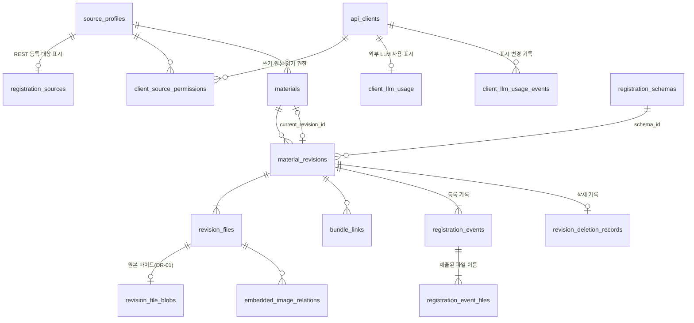

# Data Model: 문서 자료 등록·원본 보관·불변 revision·권한·스키마 사전(data-registration)

**작성일**: 2026-11-09 | **개정**: 2026-11-09(검증 지적 M-1·M-6·L-3 반영), 2026-11-10(DR-04 안전 상한, 같은 바이트 파일 번호 동점 처리) | **입력**: [spec.md](./spec.md), [research.md](./research.md) | **상태**: DR-01~DR-24 승인(2026-11-10) 반영. `DR-xx` 표시는 승인된 결정의 근거다.

이 문서는 개념 수준의 저장 구조다. 테이블·컬럼 이름은 구현 계획의 기준 이름이며 SQL·마이그레이션 코드는 아니다. 마이그레이션은 구현 단계에서 새 Alembic revision 둘로 만든다: P2a `0004`(3.1~3.4 권한·표시·등록 source 표시), P2b `0005`(3.5~3.14 스키마 사전·자료·revision·원본·기록).

## 용어

| 용어 | 뜻 |
|---|---|
| 자료 ID | 등록자가 전달하는 source 안의 유일한 자료 식별값. 저장 이름은 `material_key`다(테이블 기본 키 `id`와 구별). |
| revision | 한 자료의 불변 시점 식별값. 저장 이름은 `material_revisions.id`(UUIDv4, DR-09). |
| `sequence` | 같은 자료 ID 안에서 revision이 만들어진 순서(1부터 증가, 재사용 안 함). |
| `manifest_hash` | revision 동일성 판정값. 파일마다 (역할, 형식 판정 결과, 내용 해시), 묶음 연결, 스키마 ID의 canonical JSON SHA-256(research R-06). |
| 형식 판정 결과 | 내용 확인기가 정한 파일 형식 `xlsx`·`pdf`·`png`·`jpeg`·`text`·`markdown`. 텍스트와 Markdown은 내용으로 UTF-8 텍스트임을 판정한 뒤 선언(확장자·Content-Type)으로 나눈다(DR-23). |
| 내용 비노출 좌표 | 파일 안 글자를 담지 않는 위치 값. PDF 페이지 번호(1부터), Excel 시트 순번(0부터). |
| canonical JSON | 키 정렬·고정 구분자의 JSON. 기존 `application/indexing/hashing.py`의 `canonical_json`. |
| 내용 해시 | 파일 바이트의 SHA-256 소문자 16진 64자. 기존 `content_hash` 관례. |
| 효력 있는 원본 읽기 권한 | 활성 `read_original` 권한 행이 있고 그 호출자의 `client_llm_usage.usage = 'internal'`인 상태. 표시 행이 없으면 `외부`로 간주한다(FR-045). |
| actor | 서버 관리 경로(관리자 CLI) 실행자가 `--actor`로 밝힌 이름과 운영체제 사용자 이름(DR-10). 인증된 신원이 아니다. |
| append-only | INSERT만 허용하고 UPDATE·DELETE를 트리거로 거부. |
| 상태 전이 제한 트리거 | 정해진 컬럼의 정해진 전이만 허용하고 나머지 UPDATE·DELETE를 거부하는 트리거. |
| DR | 결정 요청. [research.md](./research.md) 3절. |

## 1. 기존 테이블과의 관계

| 기존 테이블 | 001에서의 사용 | 변경 |
|---|---|---|
| `api_clients` | 호출자. 등록자·권한 대상·표시 대상의 FK 대상. | 없음 |
| `client_source_grants` | 검색 권한(source grant). 001은 읽지도 바꾸지도 않는다(FR-028 독립). | 없음 |
| `source_profiles` | source. `factory` 행을 관리자 CLI가 만든다(`include/exclude_patterns`는 빈 배열, `active_index_run_id`는 NULL). | 컬럼 변경 없음. 행 추가만 |
| 색인·검색·정책·감사 테이블 | 사용하지 않는다(FR-035·FR-036). | 없음 |

기존 데이터 보존 불필요(사용자 결정 2026-11-09)는 001에서 활용하지 않는다. 001 마이그레이션은 새 테이블만 추가하며 기존 행을 바꾸거나 지우지 않는다(plan.md `MVP 검색 기능 영향`).

## 2. 개체 관계 개요



## 3. 개체 정의

### 3.1 `registration_sources` — REST 등록 대상 source 표시

| 필드 | 형식 | 제약 | 대응 |
|---|---|---|---|
| `source_profile_id` | UUID | PK, FK `source_profiles.id` RESTRICT | FR-040 |
| `created_at` | timestamptz | NOT NULL | FR-040 |
| `created_by_actor` | text | NOT NULL, 공백 아님 | DR-10 |

- 행이 있는 source만 REST 등록·원본 되찾기·쓰기/원본 읽기 권한 부여 대상이다. 001에서 행을 만들 수 있는 source는 `factory`뿐이다(DR-19). `omf`는 행이 없으므로 등록 요청이 없는 source와 같은 응답을 받는다(FR-002, US2-16).
- append-only.

### 3.2 `client_source_permissions` — 쓰기 권한·원본 읽기 권한

| 필드 | 형식 | 제약 | 대응 |
|---|---|---|---|
| `id` | UUID | PK | — |
| `client_id` | UUID | FK `api_clients.id` RESTRICT | FR-029 |
| `source_profile_id` | UUID | FK `registration_sources.source_profile_id` RESTRICT | FR-029, FR-040 |
| `permission` | text | `IN ('write','read_original')` | FR-028 |
| `granted_at` | timestamptz | NOT NULL | FR-041 |
| `granted_by_actor` | text | NOT NULL | DR-10 |
| `revoked_at` | timestamptz | NULL 가능 | FR-030 |
| `revoked_by_actor` | text | `revoked_at`과 함께 NULL/NOT NULL | FR-030 |
| `revoke_reason` | text | `IN ('admin_revoked','llm_usage_changed')`, `revoked_at`과 함께 | DR-11(b)(c) |

- 활성 권한 = `revoked_at IS NULL`. 부분 유일 제약 `(client_id, source_profile_id, permission) WHERE revoked_at IS NULL`로 활성 권한은 조합마다 하나다. 다시 부여하면 새 행이다.
- 상태 전이 제한 트리거: `revoked_at·revoked_by_actor·revoke_reason`을 NULL에서 값으로 한 번만 채울 수 있다. 그 밖의 UPDATE·DELETE 거부.
- `read_original` 행 INSERT는 같은 트랜잭션에서 `client_llm_usage.usage = 'internal'`을 공유 잠금으로 확인한 경우에만 허용한다(애플리케이션 규칙 + DB 트리거 이중 확인, FR-046). 거부 시 행이 생기지 않는다.
- 쓰기 권한 판정: 대상 source에 활성 `write`가 있으면 등록 가능(FR-029). 스키마 조회 판정: 어느 source든 활성 `write`가 하나라도 있으면 가능(FR-031, FR-016).

### 3.3 `client_llm_usage` — 외부 LLM 사용 표시

| 필드 | 형식 | 제약 | 대응 |
|---|---|---|---|
| `client_id` | UUID | PK, FK `api_clients.id` RESTRICT | FR-045 |
| `usage` | text | `IN ('internal','external')` | FR-045 |
| `updated_at` | timestamptz | NOT NULL | DR-11(d) |
| `updated_by_actor` | text | NOT NULL | DR-11(d) |

- 행 없음 = 표시 없음 = `외부`로 간주(FR-045). 기존 호출자(`local-agent` 등)는 행이 없다.
- 변경 규칙(DR-11 권장안): `internal`에서 `external`로 바꾸거나 행을 지우면 같은 트랜잭션에서 그 호출자의 활성 `read_original` 권한 전부를 `revoke_reason='llm_usage_changed'`로 회수한다(FR-047). `internal`로 바꿔도 회수된 권한은 복원하지 않는다.
- 호출자가 바꿀 경로는 없다(FR-045, US2-22). 변경은 관리자 CLI뿐이다.

### 3.4 `client_llm_usage_events` — 표시 변경 기록(append-only)

| 필드 | 형식 | 제약 |
|---|---|---|
| `id` | UUID | PK |
| `client_id` | UUID | FK `api_clients.id` |
| `previous_usage` | text | NULL(표시 없음) 또는 `internal`/`external` |
| `new_usage` | text | NULL(표시 해제) 또는 `internal`/`external` |
| `changed_at` | timestamptz | NOT NULL |
| `actor` | text | NOT NULL |
| `revoked_read_permission_count` | integer | `>= 0` |

### 3.5 `registration_schemas` — 스키마 사전(append-only)

| 필드 | 형식 | 제약 | 대응 |
|---|---|---|---|
| `schema_id` | text | PK, `^[A-Za-z0-9_-]{1,20}$`(대소문자 구분, `COLLATE "C"`) | FR-011, FR-015 |
| `content` | bytea | NOT NULL. 업로드 바이트 그대로 | FR-015, FR-016 |
| `content_hash` | char(64) | SHA-256 16진 | 같은 내용 판정(DR-06) |
| `format_version` | text | 예 `omf-registration-schema/v1` | DR-06 |
| `target_format` | text | `IN ('xlsx','pdf','text','image_bundle')`. `text`는 판정 형식 `text`·`markdown` 모두에 맞음 | FR-010, FR-013, DR-23 |
| `is_platform_default` | boolean | NOT NULL | FR-014, DR-07 |
| `registered_by_client_id` | UUID | NULL 가능(기본 스키마), FK `api_clients.id` | — |
| `registered_at` | timestamptz | NOT NULL | — |

- append-only 트리거(FR-015: 수정·삭제 불가, 스키마는 완전 삭제 대상이 아님).
- 플랫폼 예약 접두사 `default-`(DR-07): `is_platform_default = false`인 행은 `schema_id`가 `default-`로 시작할 수 없다(CHECK).
- 동시 등록(Edge Case): 같은 `schema_id` INSERT 충돌 시 기존 행의 `content_hash`와 비교해 같으면 재사용, 다르면 스키마 ID 충돌.
- 등록 실패 시 같은 트랜잭션이므로 새 스키마 행도 남지 않는다(FR-007, US1-6, US3-10).

### 3.6 `materials` — 자료

| 필드 | 형식 | 제약 | 대응 |
|---|---|---|---|
| `id` | UUID | PK | — |
| `source_profile_id` | UUID | FK `registration_sources.source_profile_id` | FR-037 |
| `material_key` | text | DR-08 규칙 CHECK, `COLLATE "C"` | FR-037 |
| `current_revision_id` | UUID | NULL 가능(현재본 없음) | FR-039, US1-17 |
| `last_sequence` | integer | `>= 0` | 현재본 순서 |
| `created_at` | timestamptz | NOT NULL | — |

- 유일: `(source_profile_id, material_key)`. 다른 source의 같은 자료 ID는 다른 행이다(US1-14).
- 상태 전이 제한 트리거: `current_revision_id`와 `last_sequence`만 바꿀 수 있다. DELETE 거부(자료 ID 재사용은 같은 행으로 이어 감, FR-038).
- `current_revision_id` 규칙: 새 revision 생성 시 그 revision으로 바꾼다. 현재본 revision이 완전 삭제되면 NULL로 바꾸고 직전 revision으로 되돌리지 않는다(FR-039). 현재본이 아닌 revision 삭제는 바꾸지 않는다.

### 3.7 `material_revisions` — revision

| 필드 | 형식 | 제약 | 대응 |
|---|---|---|---|
| `id` | UUID | PK. 공개 revision 식별값(DR-09) | FR-022 |
| `material_id` | UUID | FK `materials.id` | — |
| `sequence` | integer | `>= 1`, 유일 `(material_id, sequence)` | FR-038 |
| `schema_id` | text | NOT NULL, FK `registration_schemas.schema_id` RESTRICT | FR-009, FR-022 |
| `manifest_hash` | char(64) | 삭제 후 NULL(DR-12 M1) | FR-038, R-06 |
| `composition` | text | `IN ('single','image_bundle','embedded_image_bundle')` | FR-044, DR-15 |
| `inspector_version` | text | NOT NULL | R-10 |
| `created_by_client_id` | UUID | FK `api_clients.id` | FR-024 |
| `created_at` | timestamptz | NOT NULL | FR-024 |
| `state` | text | `IN ('available','deleted')` | FR-026 |
| `deleted_at` | timestamptz | `state='deleted'`일 때만 NOT NULL | FR-026 |

- 상태 전이 제한 트리거: 허용 UPDATE는 `available → deleted` 한 번(`deleted_at` 설정, `manifest_hash` NULL) 뿐이다. DELETE 거부. 그래서 삭제 뒤에도 source·자료 ID(`materials` 경유)·revision·등록자·등록 일시·스키마 ID가 남는다(FR-026, spec 2026-11-04 확정).
- 재현 불변(FR-022·FR-025): `available` 상태의 행과 그 파일·바이트·관계는 바뀌지 않는다.

### 3.8 `revision_files` — revision을 이루는 원본 파일

| 필드 | 형식 | 제약 | 대응 |
|---|---|---|---|
| `revision_id` | UUID | FK, PK 일부 | — |
| `file_index` | smallint | PK 일부, `0..20`. revision 안 파일 식별 번호. 제출 순서가 아니라 (역할, 형식 판정 결과, 내용 해시) 결정적 정렬로 매기고, 정렬 키가 같은(바이트가 같은) 파일끼리는 multipart 파트 순서로 안정 정렬하며 쪽 순서 같은 의미가 없다(DR-15 추가 결정) | 되찾기 경로, `006` 좌표 연결 |
| `role` | text | `IN ('primary','bundle_target','info')` | FR-018, FR-021 |
| `detected_format` | text | NOT NULL, `IN ('xlsx','pdf','png','jpeg','text','markdown')`. 불변(UPDATE 거부), `manifest_hash` 입력 | FR-003, FR-004, DR-23 |
| `pdf_text_layer` | text | PDF만 `IN ('full','partial','none')`, 그 외 NULL | FR-019, FR-020 |
| `byte_size` | bigint | `>= 1` | FR-006 |
| `content_hash` | char(64) | 삭제 후 NULL(DR-12 M1) | FR-022, FR-024 |

- 상태 전이 제한 트리거: 허용 UPDATE는 revision 삭제 때 `content_hash`를 NULL로 바꾸는 것뿐이다. DELETE 거부.
- 묶음 대상 파일은 순서 없는 집합이다. 제출 순서·순번을 저장하지 않는다(DR-15 추가 결정). 여러 쪽 문서는 등록 전에 PDF 하나로 합치도록 안내한다(거부 규칙 아님).
- 역할 규칙: `single` revision은 `primary` 1개. 묶음은 `info` 1개 + `bundle_target` 1~20개(DR-15). 텍스트 파일 등록은 `primary` + `detected_format ∈ {'text','markdown'}` + 기본 스키마. 정보 자료(`info`)도 `text` 또는 `markdown`이다.
- `file_index`는 `006`이 근거 좌표에서 "revision 안 어느 파일"을 가리킬 때 쓸 수 있게 둔다(plan.md `설계서 정합`).

### 3.9 `revision_file_blobs` — 원본 바이트(DR-01 권장안 A)

| 필드 | 형식 | 제약 |
|---|---|---|
| `revision_id`, `file_index` | — | PK, FK `revision_files` |
| `content` | bytea | NOT NULL |

- INSERT와 완전 삭제 시 DELETE만 허용(UPDATE 거부 트리거). DELETE는 관리자 삭제 트랜잭션에서만 일어난다(애플리케이션 경계 + 트리거가 `material_revisions.state='deleted'`를 확인).
- 같은 내용이라도 revision끼리 공유하지 않는다(Edge Case "각각 보존", 삭제 단순화).
- DR-01은 A로 승인되었다(2026-11-10). 나중에 B·C로 바꾸면 `content` 대신 `storage_ref`(저장 위치)와 2단계 쓰기 상태가 생긴다.

### 3.10 `bundle_links` — 정보 자료 묶음

| 필드 | 형식 | 제약 | 대응 |
|---|---|---|---|
| `revision_id` | UUID | PK 일부 | FR-021 |
| `target_file_index` | smallint | PK 일부, `role='bundle_target'` | FR-021 |
| `info_file_index` | smallint | `role='info'` | FR-021 |
| `human_authored_declared` | boolean | `CHECK (human_authored_declared)` | FR-021, US5-5 |

- 표시 없는 정보 자료는 등록 단계에서 거부되므로(FR-021, US5-7) 저장 행은 항상 `true`다. 그래도 기록 자체가 "사람이 쓴 설명임"의 증거이므로 컬럼으로 남긴다.
- 완전 삭제 시 행 삭제(FR-026 "관계 정보").

### 3.11 `embedded_image_relations` — 포함 이미지 관계 정보(DR-14 권장안)

| 필드 | 형식 | 제약 | 대응 |
|---|---|---|---|
| `revision_id`, `file_index` | — | FK `revision_files` | FR-020 |
| `location_kind` | text | `IN ('pdf_page','xlsx_sheet')` | DR-14 |
| `location` | integer | 내용 비노출 좌표만. PDF는 페이지 번호(1부터), Excel은 시트 순번(0부터, 워크북의 시트 순서). 시트 이름은 저장하지 않는다 | DR-14, R-11, FR-034 |
| `relation_kind` | text | `IN ('embedded_image','page_without_text_layer')` | FR-020 |
| `image_count` | integer | `embedded_image`이면 `>= 1`, 그 외 NULL | DR-14 |

- 유일: `(revision_id, file_index, location_kind, location, relation_kind)`.
- 그림 내용(픽셀, 추출 글자)은 담지 않는다(FR-017, US5-8).
- 완전 삭제 시 행 삭제(FR-026).
- 시트 이름·셀 값·문서 제목처럼 파일 안에서 읽은 값은 어느 테이블에도 저장하지 않는다(R-09, R-11). 원본 읽기 권한자는 원본 파일에서 확인한다.

### 3.12 `registration_events` — 등록 기록

| 필드 | 형식 | 제약 | 대응 |
|---|---|---|---|
| `id` | UUID | PK | FR-024 |
| `request_id` | text | NOT NULL | 운영 대조 |
| `revision_id` | UUID | FK `material_revisions.id` | FR-024 |
| `outcome` | text | `IN ('created','reused')` | FR-024, US1-12 |
| `client_id` | UUID | FK `api_clients.id`(등록자) | FR-024 |
| `occurred_at` | timestamptz | NOT NULL(등록 일시) | FR-024 |

- source·자료 ID·스키마 ID·내용 해시는 revision 경유로 확인한다(중복 저장 없음).
- append-only. 재등록(`reused`)은 새 행을 더하고 앞선 행을 바꾸지 않는다(Edge Case 첫 항목).

### 3.13 `registration_event_files` — 등록 때 제출된 파일 이름

| 필드 | 형식 | 제약 | 대응 |
|---|---|---|---|
| `event_id` | UUID | PK 일부, FK | FR-024 |
| `file_index` | smallint | PK 일부, 그 revision의 `file_index` | FR-024 |
| `submitted_filename` | text | 삭제 후 NULL, 최대 255자, 저장 위치 결정에 쓰지 않음 | FR-024, Edge Case(경로 문자) |

- 재등록은 같은 revision에 다른 이름을 낼 수 있으므로 등록 기록마다 둔다.
- 참고: 한 묶음에 바이트가 똑같은 파일이 둘 이상이면 정렬 키가 같으므로 그 등록 요청의 multipart 파트 순서로 안정 정렬해 제출 이름을 `file_index`에 대응시킨다. 결정적이지만 의미 없는 선택이다(DR-15 추가 결정의 순서 없는 집합 규칙). 파일 이름은 `manifest_hash`에 들어가지 않으므로 동일성 판정에 영향이 없다(research R-06).
- 상태 전이 제한 트리거: 허용 UPDATE는 revision 삭제 때 `submitted_filename`을 NULL로 바꾸는 것뿐이다.

### 3.14 `revision_deletion_records` — 삭제 기록(append-only)

| 필드 | 형식 | 제약 | 대응 |
|---|---|---|---|
| `id` | UUID | PK | FR-026 |
| `revision_id` | UUID | 유일, FK `material_revisions.id` | FR-026 |
| `source_key` | text | NOT NULL | FR-026 |
| `material_key` | text | NOT NULL | FR-026 |
| `content_hashes` | jsonb | 파일 순번별 내용 해시 배열 | FR-026 |
| `deleted_at` | timestamptz | NOT NULL | FR-026 |
| `deleted_by_actor` | text | NOT NULL | FR-026, DR-10 |

- 원본 내용·파일 이름·시트 이름을 담지 않는다(FR-026).
- 관리자 CLI에서만 읽는다(FR-026 "삭제 기록은 관리자가 확인한다", US2-15).

## 4. 상태 전이

### 4.1 revision

```text
(없음) --등록 성공--> available --관리자 완전 삭제--> deleted (종단)
```

- `deleted`의 되찾기·기록 조회는 없는 revision 응답(FR-043).
- `deleted` revision과 같은 내용을 다시 등록하면 FR-038에 따라 새 revision이다(삭제된 revision을 돌려주지 않음).

### 4.2 자료의 현재본

| 사건 | `current_revision_id` | `last_sequence` |
|---|---|---|
| 첫 등록 | 새 revision | 1 |
| 현재본과 `manifest_hash`가 같은 재등록 | 그대로 | 그대로 |
| 그 밖의 등록(과거 내용 포함, 현재본 없음 상태 포함) | 새 revision | +1 |
| 현재본 완전 삭제 | NULL | 그대로 |
| 현재본이 아닌 revision 완전 삭제 | 그대로 | 그대로 |

### 4.3 원본 읽기 권한의 효력

```text
부여 시도 --표시=internal--> 활성(효력 있음)
부여 시도 --표시=external/없음--> 거부, 행 없음 (FR-046)
활성 --관리자 회수--> 회수(admin_revoked)
활성 --표시 internal→external/해제--> 회수(llm_usage_changed) (FR-047, DR-11(b))
회수 --표시 internal 복귀--> 회수 유지(자동 복원 없음)
```

## 5. 검증 규칙 요약

| 규칙 | 값 | 근거 |
|---|---|---|
| 스키마 ID | `^[A-Za-z0-9_-]{1,20}$`, 대소문자 구분, 빈 문자열 거부 | FR-011 |
| 자료 ID | 1~200자 `[A-Za-z0-9._/-]`, 앞뒤 `/`·`//`·`.`/`..` 조각 금지(DR-08 승인) | FR-037 |
| 파일 크기 | 파일당 50 MiB, 요청 100 MiB 기본 설정값(DR-02 승인) | FR-006 |
| 묶음 대상 수 | 이미지·전체 스캔 PDF 1~20 또는 그림 포함 Excel·PDF 1(DR-15 승인) | FR-044 |
| 내용 확인 안전 상한 | 기본 설정값: xlsx 압축 해제 총량 512 MiB·항목별 압축 비율 100배(설정값은 양의 정수, `해제 바이트 ≤ 100 × 압축 바이트`, 0/0 항목 통과)·ZIP 항목 10,000개, PDF 2,000쪽, 파일당 확인 시간 30초. 같으면 통과, 넘으면 `unreadable_content`(DR-04, 사용자 승인 2026-11-10) | FR-005 |
| 파일 이름 | 최대 255자 기록, 초과는 앞 255자로 자르지 않고 요청 구성 사유로 거부 | FR-024 |
| 사람 작성 표시 | 묶음 요청에 `info_human_authored=true` 필수 | FR-021 |

## 6. 동시성·원자성

- 등록 트랜잭션 하나: 자료 행 잠금(advisory lock `(source, material_key)`) → 스키마 INSERT 또는 재사용 확인 → 현재본 `manifest_hash` 비교 → revision·파일·바이트·관계·등록 기록 INSERT → `materials` 갱신 → 커밋. 커밋 전 실패는 모두 되돌린다(FR-007, Edge Case 전송 중단·저장 공간 부족).
- 같은 자료 ID 동시 등록은 잠금 순서대로 처리되며 마지막 커밋이 현재본이다(Edge Case).
- 원본 되찾기: 호출자 표시 행 `FOR SHARE` → 권한 판정 → 바이트 읽기 → 커밋 후 응답 전송(DR-11(a)).
- 완전 삭제: revision 행 `FOR UPDATE` → 삭제 기록 INSERT → 바이트·묶음·관계 행 DELETE → 파일 이름·해시 NULL → revision `deleted` → 현재본이면 `materials.current_revision_id = NULL` → 커밋.

## 7. 다른 명세가 쓸 연결 지점

| 지점 | 사용처 | 비고 |
|---|---|---|
| `material_revisions.id` | `006` 색인 식별값의 원본 revision 집합(설계서 7.1), `002` 정답 근거 revision | UUID 문자열 |
| `revision_files.file_index` | `006`·`002` 위치 좌표가 묶음 안 파일을 가리킬 때 | 001은 좌표 형식을 정하지 않음 |
| `registration_schemas.schema_id` | `003` 청킹 규칙 기술자 설정 해시, `007` 매핑 | 불변 |
| `materials` + `material_revisions` 목록 | `002` 원본 자료 스냅숏(FR-010) | 001은 내부 조회만, 공개 API 없음 |
| `embedded_image_relations` | `006` 포함 이미지 관계 정보의 RAG 저장 | 위치 단위 페이지·시트 |
| `bundle_links.human_authored_declared` | `006` 검색 응답의 "사람이 쓴 설명" 표시 | — |
| `client_llm_usage` | `005` 보안 검사 적용 | 001은 원본 읽기에만 적용 |
