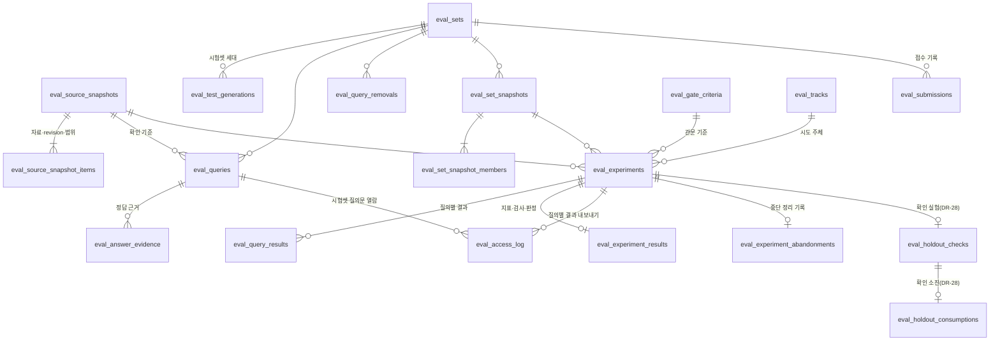

# Data Model: 평가 하네스 — 평가셋·지표·실험 기록·적용 관문(evaluation-harness)

**작성일**: 2026-11-10 | **입력**: [spec.md](./spec.md), [research.md](./research.md), [plan.md](./plan.md) | **상태**: 결정 요청 DR-01~DR-25 **승인(사용자 2026-11-10, 모두 권장안. DR-02·DR-03은 권장 A)**. `[DR-xx]`는 그 승인 결정에 의존한다는 표시다. 값 입력 대기: 관문 기준 `gpu_memory_limit_mib`(DR-04, 운영 GPU 실측값을 기록한 뒤 정함)과 연구 자원 허용 목록(DR-03). 갱신(사용자 결정 2026-11-13): 운영 서버 값은 첫 접속 때 실측해 기록하며, 운영 개시 전에는 운영 서버를 예외 표시와 함께 허용 목록에 둔다(spec FR-033, 4.2절 순서 1). 둘 다 결정 미승인이 아니며, 값이 없으면 각각 `gate_setting_missing`·`resource_not_allowed`로 거부한다(fail-closed).

**개정(2026-11-16, `012` 연동 ①~⑧)**: 3.3 `dev_role`, 3.12 목적 `holdout_check`·`gate_request_id`, 3.13 후보 목록 적중 위치·후보 수·리랭크 기록, 3.14 진단·참고 지표 키, 새 3.17·3.18(확인 실험·확인 소진), 4.2 사전 점검 2a·7a, 4.5 확인 규칙, 5절 `0008` 마이그레이션을 더했다. 모두 기존 내용을 바꾸지 않는 추가이며 결정 요청 DR-26~DR-28(research.md, **사용자 승인 2026-11-16**, DR-28은 변경 포함: 리랭커 교체 건도 확인 대상, 확인 횟수는 시험셋 세대별)에 의존한다. `[DR-26]`~`[DR-28]` 표시가 그 의존이다. 후보 목록 고정 파일(⑨)은 다음 개정에서 더한다.

이 문서는 개념 수준의 저장 구조다. 테이블·컬럼 이름은 구현 계획의 기준 이름이며 SQL·마이그레이션 코드는 아니다. 저장 위치는 플랫폼 PostgreSQL 스키마의 새 `eval_` 테이블이다[DR-01]. 평가는 연구 자원의 별도 평가 DB에서 실행한다[DR-02]. 마이그레이션은 새 Alembic revision 셋으로 만든다: P4a `0006_evaluation_datasets`(3.1~3.9), P4b `0007_evaluation_experiments`(3.10~3.16), P4c `0008_evaluation_research_linkage`(`012` 연동 추가 열과 3.17·3.18)[DR-27]. 번호는 구현 시점 head에 맞춘다(research R-13).

## 용어

| 용어 | 뜻 |
|---|---|
| source, 자료 ID, revision, 위치 좌표, 정답 근거, 평가 질의, 평가셋, 시험셋, 개발셋, 스냅숏, 구성, 관문, 관문 시도, 연구 트랙, 모듈 교체 건 | spec 용어표와 같다. |
| 원본 자료 스냅숏 | 평가에 쓰는 (source, 자료 ID, revision) 목록과 그 범위 정보를 고정한 것(FR-010). |
| 범위 정보(`extent`) | 좌표가 revision 안에 있는지 확인하는 데 필요한 값. 텍스트는 행 수, PDF는 페이지 수, Excel은 시트 이름과 사용 범위, 묶음은 파일별 값. 원문 내용은 담지 않는다. |
| 평가셋 스냅숏 | 특정 시점의 평가셋 구성원(질의 ID와 평가 가능 여부)을 고정한 것(FR-009). |
| 시험셋 세대 | 관문 시도 횟수를 세는 단위. 승인된 보충으로만 바뀐다[DR-08]. |
| 트랙 | 연구 트랙 ①~③과 모듈 교체 건을 함께 부르는 말. 시도 횟수를 세는 주체다. |
| 실험 | 두 구성을 같은 평가셋 스냅숏·원본 자료 스냅숏으로 비교한 실행 한 번. 종류는 `dev`(개발셋), `gate`(관문 시도), `reproduction`(재현), `transition_check`(전환 확인)[DR-19]. |
| 구성 역할 | 실험 안에서 구성이 맡는 쪽. `current`(현재 구성) 또는 `candidate`(후보 구성). |
| 실행 차수 | 같은 실험에서 질의 결정성 검사를 위해 같은 구성으로 평가셋을 두 번 실행할 때의 순번(1, 2)[DR-13]. |
| append-only | INSERT만 허용하고 UPDATE·DELETE를 트리거로 거부(R-07). |
| 상태 전이 제한 트리거 | 정해진 컬럼의 정해진 전이만 허용하고 나머지 UPDATE·DELETE를 거부하는 트리거. |
| 정규화 질의문 | NFC, 앞뒤 공백 제거, 연속 공백 하나로 바꾼 질의문(research R-02). |
| NFC | 유니코드 정규화 형식의 하나. 한글 음절을 한 글자로 합친 형태로 맞춰, 눈에 같은 글자를 바이트로도 같게 한다. |
| KST | 한국 표준시(UTC+9). |
| FK, PK | 외래 키(다른 테이블 행을 가리키는 컬럼), 기본 키(행을 식별하는 컬럼). |
| 개발셋·시험셋 현재 구성원 | 그 평가셋에 접수되었고 제거(3.7)되지 않은 질의. |
| canonical JSON, 정규화 해시 | 기존 `application/indexing/hashing.py`의 `canonical_json`과 그 SHA-256(`config_hash`). |
| 분수 표기 | 비율을 `{"num": 분자, "den": 분모, "decimal": "0.612500"}`로 저장하는 형식(research R-01). |
| actor | 변경 명령 실행자가 `--actor`로 밝힌 이름과 운영체제 사용자 이름(001 관리자 CLI와 같은 형식 `"<actor> (os:<user>)"`). 인증된 신원이 아니다. |
| DR, R-xx | [research.md](./research.md)의 결정 요청과 기술 판단. |
| 후보 목록, 리랭커, 리랭크 적용 상태, 통과 모듈, 진단 지표, 참고 지표, Recall@N(후보 목록), 탐색·확인 개발셋, 확인 실험, 확인 소진, 후보 대조 키 | research.md 용어표와 같다(`012` 연동 개정 2026-11-16). |
| 관문 요청 id(`gate_request_id`) | 관문 시도 요청이 사전 점검 2a에 들어올 때 실행기가 만드는 UUID. 확인 소진 기록과 그 요청의 실험 행을 잇는다[DR-28]. |
| 확인 입력 식별값(`holdout_identity_sha256`) | 확인 실험이 읽은 확인 입력과 현재 구성을 가리키는 SHA-256. 이 개정은 확인 개발셋 스냅숏 종류만 정의한다[DR-28]. |

## 1. 기존 테이블과의 관계

| 기존 테이블 | 002에서의 사용 | 변경 |
|---|---|---|
| `index_runs`, `index_configs`, `document_occurrences`, `document_contents`, `document_parses`, `sections`, `chunks`, `chunk_embeddings` | 비공개 평가 경로가 run id로 읽는다. 필수 검사가 청크·좌표를 읽는다. 원본 자료 스냅숏과 run의 일치 확인(R-10)이 occurrence·내용 해시를 읽는다. | 없음(읽기만) |
| `search_policy_manifests` | 두 구성의 정책을 `config_hash`로 resolve한다. 후보 정책은 평가 실행기가 기존 저장소 함수로 등록한다(설계서 D-11). | 컬럼 변경 없음. 행 추가만 |
| `source_profiles` | OMF 원본 자료 스냅숏 생성 시 포함·제외 패턴을 읽는다. 활성 포인터는 읽지도 바꾸지도 않는다. | 없음 |
| `api_clients`, `client_source_grants`, `search_audit_events` | 쓰지 않는다. 비공개 평가 경로는 grant를 보지 않고(서버 셸 전용) 감사 행을 남기지 않는다. | 없음 |
| 001 테이블(`materials`, `material_revisions`, `revision_files` 등) | factory 원본 자료 스냅숏 생성 시 revision과 범위 정보를 읽는다(P13)[DR-22]. 외래 키를 두지 않는다(R-13). | 없음 |

002 마이그레이션은 새 테이블만 추가하며 기존 테이블의 컬럼·제약·행을 바꾸지 않는다.

## 2. 개체 관계 개요



## 3. 개체 정의

공통: 모든 `created_at`은 `timestamptz NOT NULL DEFAULT now()`. 표의 "불변"은 append-only 트리거다.

### 3.1 `eval_source_snapshots` — 원본 자료 스냅숏(FR-010, FR-003b)

| 컬럼 | 형식 | 규칙 |
|---|---|---|
| `id` | text PK | 시스템 발급 `SNAP-YYYYMMDD-NN`(KST 날짜, 그날 순번 01~99)[DR-10]. CHECK 정규식 |
| `description` | text NULL | 1~200자 |
| `items_hash` | char(64) | 항목 (source, 자료 ID, revision, 내용 해시) 정렬 목록의 정규화 해시 |
| `item_count` | integer | ≥ 1 |
| `revision_summary` | jsonb | source별 자료 수와 revision 요약(OMF는 commit SHA 하나). 목록 출력용 |
| `created_by` | text | actor |
| `created_at` | timestamptz | |

불변. 같은 `items_hash`의 스냅숏을 다시 만들면 새로 만들지 않고 기존 ID를 돌려준다(멱등).

### 3.2 `eval_source_snapshot_items` — 스냅숏 항목

| 컬럼 | 형식 | 규칙 |
|---|---|---|
| `snapshot_id` | text FK → 3.1 | |
| `source_key` | text | `omf` 또는 `factory` |
| `material_id` | text | OMF는 저장소 기준 파일 경로(spec 임시 규칙), factory는 001 자료 ID |
| `revision` | text | OMF는 40자 commit SHA, factory는 001 revision UUID |
| `file_count` | integer | OMF는 1. 묶음 revision은 파일 수 |
| `composition` | text | 001 `material_revisions.composition`을 그대로 복사: `single`, `image_bundle`(001 표 B5: 대상이 이미지·전체 스캔 PDF), `embedded_image_bundle`(001 표 B6: 그림 포함 Excel·PDF·일부 스캔 PDF 대상 1개). OMF는 `single`. CHECK. 파일 결정 규칙(3.6)의 입력이다 |
| `extent` | jsonb | 파일 번호별 범위 정보. 텍스트·Markdown `{"kind":"lines","line_count":n}`, PDF `{"kind":"pages","page_count":n}`, Excel `{"kind":"sheets","sheets":[{"name":…,"max_row":…,"max_col":…}]}`. 원문 내용은 담지 않는다 |
| `formats` | jsonb | 파일 번호별 형식(`markdown`, `text`, `pdf`, `xlsx`, `png`, `jpeg`)과 역할. 역할 이름은 001과 같다: `primary`(단일 revision), `info`(묶음의 정보 자료, 정확히 1개), `bundle_target`(묶음 대상 1~20개). OMF는 `primary` |
| `content_hash` | char(64) | OMF는 파일 바이트 SHA-256. factory는 001 `manifest_hash` |

PK (`snapshot_id`, `source_key`, `material_id`). 불변. OMF 행은 고정 commit의 git 객체에서 읽어 만든다(OMF 저장소 읽기 전용). factory 행은 P13[DR-22].

### 3.3 `eval_sets` — 평가셋(FR-001)

| 컬럼 | 형식 | 규칙 |
|---|---|---|
| `name` | text PK | 1~40자, `[a-z0-9-]` |
| `kind` | text | `test` 또는 `dev`. CHECK |
| `dev_role` | text NULL | (`0008` 추가)[DR-28] 개발셋 역할 `exploration`·`holdout`. CHECK: `kind = test`이면 NULL, 값이 있으면 두 값 중 하나. 새로 INSERT하는 `kind = dev` 행은 NOT NULL(BEFORE INSERT 트리거, 생성 명령 기본 `exploration`). `0008` 적용 전에 있던 `kind = dev` 행은 NULL로 남고 **`exploration`으로 읽는다**(유효 역할 = `coalesce(dev_role, 'exploration')`). 이렇게 해서 마이그레이션이 append-only 트리거를 끄거나 기존 행을 UPDATE하지 않는다(독립 검증 발견 F-4) |
| `created_by`, `created_at` | | |

불변. 역할도 만들 때 정하고 바꾸지 않는다. 한 질의는 한 평가셋에만 속한다(3.5 PK가 평가셋을 포함하고 질의를 다른 평가셋으로 옮기는 경로가 없음).

### 3.4 `eval_test_generations` — 시험셋 세대[DR-08]

| 컬럼 | 형식 | 규칙 |
|---|---|---|
| `set_name` | text FK → 3.3(`kind = test`만, 트리거로 확인) | |
| `generation` | integer | 1부터. 첫 세대는 시험셋 생성 때 자동 |
| `opened_at_snapshot_id` | text NULL FK → 3.8(`eval_set_snapshots`) | 세대를 연 스냅숏. 첫 세대는 NULL |
| `new_answerable_count`, `new_answerable_by_intent`, `new_no_answer_count` | integer, jsonb, integer | 직전 세대 이후 새로 접수된 사람 작성 질의 수. 보충 조건 확인 근거 |
| `approval_ref` | text NULL | 첫 세대 외 필수 |
| `opened_by`, `opened_at` | | |

PK (`set_name`, `generation`). 불변. 현재 세대 = 가장 큰 `generation`.

### 3.5 `eval_queries` — 평가 질의(FR-003, FR-003a, FR-008)

| 컬럼 | 형식 | 규칙 |
|---|---|---|
| `set_name` | text FK → 3.3 | |
| `query_id` | text | 시스템 발급 `Q-000001`, 평가셋 안 순번, 재사용 없음[DR-10] |
| `query_text` | text | 1~1000자, 공백만 불가 |
| `normalized_text` | text | 정규화 질의문(R-02) |
| `intent` | text | `무엇`, `왜`, `어떻게`. CHECK. 문서에 없는 질의도 필수 |
| `answer_status` | text | `정답 있음`, `정답 없음`. CHECK |
| `basis_snapshot_id` | text FK → 3.1 | 확인 기준 원본 자료 스냅숏 |
| `author` | text | 1~100자 |
| `authored_on` | date | 작성일 |
| `origin` | text | `사람 작성`, `템플릿`, `합성`. CHECK. 시험셋은 `사람 작성`만(트리거로 평가셋 종류와 대조), 개발셋은 `템플릿`·`합성`만 |
| `provenance` | jsonb NULL | 템플릿: 템플릿 파일 해시·행 번호. 합성: 모델 이름(서버 보고값), 요청 매개변수, 프롬프트 템플릿 버전·해시, 생성 시각, 입력 구간 좌표[DR-16]. 사람 작성은 NULL |
| `submission_id` | uuid FK → 3.9 | 접수 기록 |
| `created_at` | timestamptz | |

PK (`set_name`, `query_id`). 불변. 질의 내용을 고치는 경로는 없다(제거 3.7 후 새 질의로 다시 접수).

### 3.6 `eval_answer_evidence` — 정답 근거(FR-003, FR-004)

| 컬럼 | 형식 | 규칙 |
|---|---|---|
| `set_name`, `query_id` | FK → 3.5 | |
| `ordinal` | integer | 질의 안 순번 0부터 |
| `source_key`, `material_id`, `revision` | text | `basis_snapshot_id`의 항목에 있어야 함(접수 시 확인) |
| `file_index` | integer | 0 이상. 작성자가 적지 않고 시스템이 3.2 `composition`·`formats`와 좌표 종류로 정한다: `single` → `primary`(좌표 종류는 그 파일 형식과 맞아야 함). `image_bundle` + 행 범위 → `info`, + 페이지·셀 → `kind_format_mismatch`(전체 스캔 PDF 하나만 대상이어도 같음). `embedded_image_bundle` + 행 범위 → `info`, + 페이지 → 형식 `pdf`인 `bundle_target`, + 셀 → 형식 `xlsx`인 `bundle_target`, 맞는 형식의 대상이 없으면 `kind_format_mismatch`[DR-07] |
| `coordinate_kind` | text | `lines`, `pages`, `cells`. CHECK |
| `start_line`, `end_line` | integer NULL | `lines`: 1 ≤ start ≤ end ≤ 행 수 |
| `start_page`, `end_page` | integer NULL | `pages`: 1 ≤ start ≤ end ≤ 페이지 수 |
| `sheet_name`, `cell_range` | text NULL | `cells`: 시트 이름 정확 비교, A1 범위. 저장 시 `min_row`, `max_row`, `min_col`, `max_col` 정수도 함께 저장 |

PK (`set_name`, `query_id`, `ordinal`). CHECK: 종류별로 해당 컬럼만 NOT NULL. 불변. 정답 없음 질의는 행이 없다(FR-005, 트리거 아닌 접수 규칙과 3.8 스냅숏 생성 시 재확인).

### 3.7 `eval_query_removals` — 질의 제거

| 컬럼 | 형식 | 규칙 |
|---|---|---|
| `set_name`, `query_id` | FK → 3.5 | PK. 한 번만 |
| `reason` | text | `author_withdrawn`, `revision_deleted`(001 완전 삭제로 평가 불가 표시와 함께), `other` |
| `note` | text NULL | 1~200자 |
| `removed_by`, `removed_at` | | |

불변. 제거해도 질의 행과 그 질의를 쓴 실험 기록은 그대로다(US5-5).

### 3.8 `eval_set_snapshots`, `eval_set_snapshot_members` — 평가셋 스냅숏(FR-009)

`eval_set_snapshots`:

| 컬럼 | 형식 | 규칙 |
|---|---|---|
| `id` | text PK | `<평가셋 이름>@<순번>`[DR-10] |
| `set_name` | text FK → 3.3 | |
| `sequence` | integer | 평가셋 안 1부터 |
| `generation` | integer NULL | 시험셋이면 그 시점의 세대(3.4) |
| `members_hash` | char(64) | 구성원 (질의 ID, 평가 가능 여부) 정렬 목록의 정규화 해시 |
| `counts` | jsonb | 평가 가능한 정답 있음 질의 수, 그 의도별 수, 문서에 없는 질의 수, 정답 2개 이상 질의 수, 평가 불가 수 |
| `scale_ok` | boolean | 시험셋이면 FR-002 규모 충족 여부(평가 가능 질의 기준, DR-12). 개발셋은 NULL |
| `created_by`, `created_at` | | |

`eval_set_snapshot_members`: (`snapshot_id`, `query_id`) PK, `evaluable` boolean, `unevaluable_reason` text NULL(`revision_deleted`).

둘 다 불변. 질의 접수 1회(파일 하나)와 제거 1회마다 새 스냅숏을 하나 만든다. 구성원 = 접수된 질의 − 제거된 질의.

### 3.9 `eval_submissions` — 접수 기록

| 컬럼 | 형식 | 규칙 |
|---|---|---|
| `id` | uuid PK | |
| `set_name` | text FK → 3.3 | |
| `kind` | text | `human_file`, `template`, `synthesized` |
| `file_hash` | char(64) | 제출 파일 바이트 SHA-256 |
| `accepted_count` | integer | 접수 건수(전부 또는 전무[DR-10]이므로 0이면 거부된 제출) |
| `rejected_reasons` | jsonb | 거부 시 배열 위치별 사유 코드 목록(질의문 등 내용은 담지 않음) |
| `resulting_snapshot_id` | text NULL FK → 3.8 | 접수 시 만든 스냅숏 |
| `excluded_counts` | jsonb NULL | (`0008` 추가)[DR-28] 접수 때 자동으로 뺀 질의 수 `{"test_duplicate":n,"exploration_duplicate":n,"holdout_duplicate":n}`(정수 ≥ 0, 질의문 없음). 행 INSERT 때만 채우며 append-only와 맞는다. `0008` 이전 행은 NULL. 사람 작성 시험셋 제출(제외 없음, 거부만 있음)은 NULL |
| `submitted_by`, `created_at` | | |

불변. SC-003 검토 증거(작성자별 거부 0건 확인)에 쓴다.

### 3.10 `eval_gate_criteria` — 관문 기준(FR-018, FR-022)[DR-15]

| 컬럼 | 형식 | 규칙 |
|---|---|---|
| `config_hash` | char(64) PK | `settings` 정규화 해시 |
| `name` | text | `개선 폭 기준` |
| `version` | text | `1.0` |
| `settings` | jsonb | 아래 표 |
| `approval_ref` | text | 코드 상수에 적힌 승인 참조값(예: `user-approval-2026-11-08`) |
| `registered_at` | timestamptz | |

UNIQUE (`name`, `version`). 불변. 실행기가 코드 상수에서 멱등 등록한다.

`settings`(v1.0 권장 기본값):

| 키 | 값 | 출처 |
|---|---|---|
| `min_answerable`, `min_per_intent`, `min_no_answer` | 400, 100, 50 | FR-002 |
| `recall_improvement_min_pp` | 3 (이상 통과) | FR-018 ② |
| `ci_lower_bound_exclusive` | 0 (초과 통과) | FR-018 ③ |
| `intent_drop_max_pp_exclusive`, `secondary_drop_max_pp_exclusive` | 5, 2 (미만 통과) | FR-018 ④ |
| `latency_p95_increase_max_ms` | 200 (이하 통과) | FR-018 ⑤ |
| `reindex_max_seconds` | 28800 (이하 통과) | FR-018 ⑤ |
| `gpu_memory_limit_mib` | **미정**(운영 GPU 실측 총 메모리 −10%. 총 메모리는 운영 서버 첫 접속 때 실측해 기록, 사용자 결정 2026-11-13)[DR-04] | FR-018 ⑤ |
| `no_evidence_rate_not_lower` | true | FR-018 ⑤ |
| `bootstrap` | `{"method":"percentile","resamples":10000,"seed":20261108,"rng":"sha256-counter-v1","quantile":"nearest-rank"}`[DR-05] | FR-018 ③ |
| `metric_definition_version` | `metrics-v1`(DR-11의 1~7)[DR-06·DR-11] | FR-011~014a |
| `max_attempts_per_track` | 3 | FR-025 |
| `replenish` | `{"new_answerable_min":100,"new_per_intent_min":25,"new_no_answer_min":10}`[DR-08] | FR-026 |
| `author_review_sample_min` | 20 | SC-003 |

`gpu_memory_limit_mib`가 정해지기 전에는 관문 시도를 사전 점검 `gate_setting_missing`으로 거부한다.

### 3.11 `eval_tracks` — 연구 트랙과 모듈 교체 건(FR-023, FR-025)[DR-09]

| 컬럼 | 형식 | 규칙 |
|---|---|---|
| `track_id` | text PK | 연구 트랙: `track-1-parsing`(`013`), `track-2-reranker`(`012`), `track-3-embedding`(`014`). 교체 건: `swap-<모듈 종류>-<순번>` |
| `kind` | text | `research`, `module_swap` |
| `spec_ref` | text NULL | 연구 트랙의 명세 번호 |
| `module_kind` | text NULL | 교체 건: `parser`, `region`, `chunking`, `enrichment`, `embedding`, `reranker`(설계서 5절) |
| `description` | text | 1~200자 |
| `approval_ref` | text NULL | 교체 건 필수 |
| `registered_by`, `registered_at` | | |

불변. 연구 트랙 3행은 마이그레이션이 넣는다.

### 3.12 `eval_experiments` — 실험(FR-028, FR-017)

| 컬럼 | 형식 | 규칙 |
|---|---|---|
| `id` | uuid PK | 실행기가 클라이언트에서 만든 UUIDv4(생존 잠금 키의 재료)[DR-25] |
| `kind` | text | `dev`, `gate`, `reproduction`, `transition_check`. CHECK |
| `purpose` | text | `tuning`, `improvement`, `bugfix_check`, `reproduction`, `transition`, `holdout_check`(`0008` 추가, `dev`이고 평가셋 역할 `holdout`일 때만, 트리거로 확인[DR-28]). 관문 시도는 `improvement`만[DR-20] |
| `set_snapshot_id` | text FK → 3.8 | `gate`이면 시험셋 스냅숏, `dev`이면 개발셋 스냅숏 |
| `set_name` | text FK → 3.3 | `set_snapshot_id`의 평가셋(트리거로 일치 확인). 시도 횟수 집계 키 |
| `source_snapshot_id` | text FK → 3.1 | |
| `current_config`, `candidate_config` | jsonb | 구성마다 `run_id`, 색인 식별값과 snapshot 원문, 정책 `config_hash`와 snapshot 원문, 질의 임베딩 기술자, 재색인 측정 run id(R-08, DR-14) |
| `seed` | bigint | `gate`이면 관문 기준의 시드만 허용(트리거·사전 점검)[DR-05] |
| `criteria_hash` | char(64) NULL FK → 3.10 | `gate`·`reproduction`(관문 시도 재현)이면 필수 |
| `track_id` | text NULL FK → 3.11 | `gate`이면 필수. 목적 `holdout_check`이면 필수(확인 횟수의 주체, 연구 트랙 또는 리랭커 교체 건)[DR-28] |
| `generation` | integer NULL | `gate`이면 시험셋 세대 |
| `attempt_number` | integer NULL | `gate` 행은 NULL로 INSERT하고, **첫 시험셋 질의별 결과(3.13)를 저장하는 트랜잭션에서 한 번만** 값을 정한다(트랙별 advisory lock 아래, 그 행의 `generation`에서 값 있는 시도 수 + 1. 실행 중 새 세대가 열려도 행의 세대를 쓴다)[DR-24]. 값이 있는 `gate` 행만 시도로 센다. CHECK `attempt_number >= 1`. 상한은 설정값(3.10 `max_attempts_per_track`)이라 CHECK에 고정하지 않고, 값을 정하는 UPDATE 때 트리거가 `criteria_hash`가 가리키는 기준 행의 `settings.max_attempts_per_track` 이하인지 확인한다(시드 확인과 같은 방식). 사전 점검(4.2의 9)이 먼저 같은 값으로 거부한다 |
| `reproduces_experiment_id` | uuid NULL FK → 3.12 | `reproduction`이면 필수 |
| `gate_request_id` | uuid NULL | (`0008` 추가)[DR-28] 확인이 필요한 트랙의 `gate` 행이면 필수: 사전 점검 2a가 만든 관문 요청 id(3.18). 그 밖 NULL. UNIQUE(값이 있을 때) |
| `approval_ref` | text NULL | `bugfix_check`·`transition_check` 필수 |
| `resource_name` | text | 허용 목록의 연구 자원 이름[DR-03]. 운영 개시 전 예외로 운영 서버에서 실행한 실험(허용 항목에 `pre_launch_exception: true`)은 "운영 서버(운영 개시 전 예외)"(spec FR-033 조건 ③, 사용자 결정 2026-11-13) |
| `environment` | jsonb | 호스트, GPU 이름·UUID·총 메모리, CPU, 드라이버, Python·torch·sentence-transformers 버전, 장치 문자열, 측정 방식 설명(R-16) |
| `status` | text | `running` → `completed` 또는 `failed` |
| `failure_code` | text NULL | 고정 코드(원문·질의문 없음). 중단 정리면 `abandoned`, 실행기가 생존 잠금을 잃고 스스로 끝내면 `liveness_lost`[DR-25] |
| `started_by`, `started_at`, `finished_at` | | `finished_at`은 상태 전이 때 한 번 |

- 상태 전이 제한 트리거: `status`는 `running`에서 `completed`·`failed`로 한 번만, 그때 `finished_at`·`failure_code`만 채울 수 있다. 또 `status = 'running'`인 `gate` 행의 `attempt_number`를 NULL에서 값으로 한 번만 바꿀 수 있다[DR-24]. `failure_code = 'abandoned'`인 `running → failed`는 같은 트랜잭션에 3.16 행이 있을 때만 허용한다[DR-25]. 다른 컬럼 UPDATE와 DELETE는 거부.
- 생존 표시[DR-25]: 실행기는 실험 `id`를 클라이언트에서 만들고, 풀 밖 전용 연결에서 생존 잠금 (`EVAL_LIVENESS_CLASS`, id 해시 int4)을 기다리지 않는 `pg_try_advisory_lock`으로 얻은 **뒤** 이 행을 INSERT·커밋하며, 끝날 때까지 잠금을 쥔다. 얻지 못하면(objid 우연 충돌) 새 UUID로 다시 시도하고 5회 모두 실패하면 행을 만들지 않고 exit 4 `liveness_lock_unavailable`로 끝난다(실험 종류 무관). 연결이 끊기면 PostgreSQL이 잠금을 풀므로 `running`인데 잠금이 없는 행은 중단된 실험이다. 잠금 키·전용 연결·keepalive·상실 시 동작은 research DR-25.
- 시도 유일성: UNIQUE (`set_name`, `generation`, `track_id`, `attempt_number`) WHERE `kind = 'gate' AND attempt_number IS NOT NULL`. 진행 중 시도 하나: 부분 UNIQUE 인덱스 `eval_experiments_running_track_uq` (`set_name`, `generation`, `track_id`) WHERE `kind = 'gate' AND status = 'running'`(FR-026의 "한 번에 후보 1개"를 동시 실행에도 강제. 인덱스 이름은 아래 오류 대응에 쓰이므로 고정). 사전 점검 9를 함께 통과한 두 시도 중 뒤쪽 INSERT가 유일성 위반(SQLSTATE `23505`)으로 실패하고 오류의 위반 제약 이름(`constraint_name`)이 `eval_experiments_running_track_uq`일 **때만** 실행기는 exit 3 `attempt_in_progress`로 끝낸다(행 없음, 시도로 세지 않음, 자기 생존 잠금 해제)[DR-25]. 다른 제약·인덱스의 `23505`(예: 실험 id PK 충돌)는 예기치 않은 오류로 기존 내부 오류 경로(exit 4)로 처리한다.
- 실험 행(모든 종류)은 사전 점검 통과 → 색인 쪽 필수 검사 계산 → 모델 적재·예열 질의를 **끝낸 뒤**, 첫 평가셋 질의 실행 직전에 INSERT·커밋한다. 그 전 단계의 오류는 행을 남기지 않는다. 행이 있다는 것만으로는 시도로 세지 않는다: `gate`는 첫 질의별 결과가 저장되며 `attempt_number`가 정해질 때부터 센다[DR-24]. 첫 결과 저장 전에 실패하면 `failed`, `attempt_number` NULL로 남고 시도로 세지 않는다(spec Edge Case). 색인 쪽 필수 검사 결과는 메모리에 두었다가 3.14 결과 행에 함께 넣는다.

### 3.13 `eval_query_results` — 질의별 결과(FR-015)

| 컬럼 | 형식 | 규칙 |
|---|---|---|
| `experiment_id` | uuid FK → 3.12 | |
| `config_role` | text | `current`, `candidate` |
| `pass_number` | integer | 1 또는 2(질의 결정성)[DR-13] |
| `query_id` | text | 실험 스냅숏의 구성원 |
| `status` | text | `ok`, `no_evidence` |
| `latency_ms` | integer | ≥ 0(R-16) |
| `evidence` | jsonb | 순위 1~20 근거 항목 배열. 항목마다 `rank`, `parent_id`, `matches[]`(`chunk_id`, `line_start`, `line_end`, `length_cp`, 그리고 `012` 연동 ③의 `rerank_score`(0~1 실수 또는 null), `rerank_rank`(정수 또는 null), `reranked`(참·거짓)[DR-27]), `origins[]`(`source_key`, `material_id`, `revision`, `file_index`), `rrf_score`(분수 아님, 기록용). 리랭커가 없으면 리랭크 필드는 null·null·거짓 |
| `hit_ranks` | integer[] | 적중한 근거 항목 순위 목록(정답 있음 질의만) |
| `hit_answer_ordinals_top5` | integer[] | 상위 5개에서 적중한 정답 근거 `ordinal` 목록 |
| `top5_length_cp` | integer[] | 상위 5개 근거 항목 길이(코드 포인트)[DR-06] |
| `candidate_hit_position` | integer NULL | (`0008` 추가)[DR-27] 후보 목록에서 정답 근거와 겹치는 첫 후보의 위치(1부터, 그 구성이 쓴 순서). 정답 없음 질의·겹침 없음이면 NULL(research R-21) |
| `candidate_count` | integer NULL | (`0008` 추가)[DR-27] 그 질의의 결합 결과 후보 수(잘리기 전 전체 수, 경로 결과의 `candidate_total`). 100을 넘으면 그 질의의 후보 목록은 앞 100개로 잘렸고 적중 위치도 그 안에서만 찾는다(DR-26 3, R-21). 정답 없음 질의도 기록 |
| `rerank_status` | text NULL | (`0008` 추가)[DR-27] 리랭크 적용 상태. CHECK 다섯 값(`applied`, `not_applied_error`, `not_applied_timeout`, `passthrough`, `skipped_no_candidates`). 평가 실행기는 `applied`·`passthrough`·`skipped_no_candidates`만 쓴다(미적용은 오류로 끝남, DR-26 4) |
| `rerank_ms` | integer NULL | (`0008` 추가)[DR-27] 리랭크 소요 시간 ms(올림, ≥ 0). `passthrough`·`skipped_no_candidates`면 0 |

PK (`experiment_id`, `config_role`, `pass_number`, `query_id`). 불변. 원문(`excerpt`)은 저장하지 않는다(길이만). 후보 목록 자체도 저장하지 않는다(적중 위치·후보 수만)[DR-27]. 질의마다 두 구성의 결과를 한 트랜잭션으로 저장·커밋한다(실험 끝에 몰아 저장하지 않음). `gate`의 첫 질의 저장 트랜잭션이 `attempt_number`도 정한다[DR-24]. 실패한 실험의 일부 결과도 남는다. **결과 가드**[DR-25]: BEFORE INSERT 트리거가 부모 3.12 행을 `FOR SHARE`로 읽어 `status = 'running'`이 아니면 거부한다(정리·실패 뒤 좀비 쓰기 차단). 실행기의 쓰기 트랜잭션은 부모 행을 **가장 먼저** `FOR NO KEY UPDATE`로 잠근 뒤 이 표에 INSERT하므로 가드의 `FOR SHARE`가 잠금 승격을 일으키지 않는다. 순서: 부모 행 잠금 → (`gate` 첫 결과만) 트랙 잠금·`attempt_number` → INSERT → 생존 잠금 자기 확인 → 커밋(research DR-25 `트랜잭션 안 순서`). 재계산(SC-002)은 이 표와 3.10·3.12만으로 한다.

### 3.14 `eval_experiment_results` — 지표·필수 검사·비용·판정(FR-028)

| 컬럼 | 형식 | 규칙 |
|---|---|---|
| `experiment_id` | uuid PK FK → 3.12 | 실험이 `completed`로 바뀌는 트랜잭션에서 상태 전이 **전에** 한 번 INSERT. 3.13과 같은 결과 가드 트리거(부모가 `running`일 때만)[DR-25]. 완료 트랜잭션 순서: 부모 행 `FOR NO KEY UPDATE` → 이 행 INSERT → 생존 잠금 자기 확인(상실이면 커밋 없이 `liveness_lost`) → `completed` UPDATE → 커밋 |
| `metrics` | jsonb | 구성별 Recall@5, MRR@20, 근거 완전성(또는 `"not_applicable"`), 의도별 Recall@5, `no_evidence` 비율, 반환 근거 평균 길이(전체·정답 있음). 모두 분수 표기. `012` 연동 추가 키(관문 판정·관문 기준 해시에 쓰지 않음)[DR-27]: `diagnostic.recall_at_n_candidates`(`"5"`·`"10"`·`"20"`·`"30"`·`"50"`·`"max"` → 분수), `diagnostic.candidate_count`(`min`·`median`·`max`), `diagnostic.upper_gap_pp`(분수), `diagnostic.truncated_queries`, `reference.mrr_at_3`(분수), `reference.ndcg_at_3`(`{"value","decimal","precision"}`, binary64). 실험 수준(구성별 아님) 키: `reference.delta`(후보 − 현재), `single_config`(R-18), `reference_metrics_version`(`reference-v1`). 정답 있는 질의 0개면 해당 값 `"not_applicable"` |
| `mandatory_checks` | jsonb | 구성별 5종 각각 `pass`·`fail`·`not_run`과 위반 수·대표 위반 좌표(원문 없음) |
| `costs` | jsonb | 구성별 지연 p95(ms), 재색인 소요 시간(초 또는 `not_measured`), GPU 메모리 최대(MiB 또는 `not_measured`), 측정 방법. `012` 연동 추가: 구성별 `rerank_ms`(`p95`·`p99`, nearest-rank)[DR-27], 측정 run 공유 표시 `reindex_measurement_shared`(R-19) |
| `paired` | jsonb | 불일치율(분수), 부트스트랩 하한·상한(분수), 재표본 수, 시드 |
| `judgment` | text NULL | `gate`: `적용 권고`, `불합격`, `유의한 차이 없음(현재 유지)`. 그 밖: NULL |
| `reasons` | jsonb NULL | 조건 ①~⑤마다 통과 여부, 측정값, 기준값(FR-020) |
| `reproduction_match` | jsonb NULL | `reproduction`: 원 실험과 질의별 결과·품질 지표·필수 검사 일치 여부와 불일치 수(FR-030) |
| `discordance_check` | jsonb NULL | 첫 관문 시도에서 측정 불일치율과 가정 10% 비교 표시(spec 열린 항목) |

불변.

### 3.15 `eval_access_log` — 시험셋 내용 열람 기록[DR-21]

시험셋의 질의별 결과 내보내기와 시험셋 질의문 열람을 한 테이블에 남긴다.

| 컬럼 | 형식 | 규칙 |
|---|---|---|
| `id` | uuid PK | |
| `kind` | text | `per_query_export`(`eval experiment export --per-query`), `test_query_text`(`eval query show --include-text`). CHECK |
| `experiment_id` | uuid NULL FK → 3.12 | `per_query_export`이면 필수, 그 밖 NULL |
| `set_name`, `query_id` | text NULL, FK → 3.5 | `test_query_text`이면 둘 다 필수, 그 밖 NULL |
| `reason` | text | 1~200자 |
| `accessed_by`, `accessed_at` | | actor, 시각 |

CHECK: `kind`별 필수 컬럼(위)과 나머지 NULL. 불변. 개발셋 결과·질의문 열람과 시험셋의 집계 출력은 기록하지 않는다.

### 3.16 `eval_experiment_abandonments` — 중단된 실험 정리 기록[DR-25]

| 컬럼 | 형식 | 규칙 |
|---|---|---|
| `experiment_id` | uuid PK FK → 3.12 | 한 실험에 한 번 |
| `reason` | text | 1~200자 |
| `attempt_number_at_abandon` | integer NULL | 정리 시점의 `attempt_number`. 값이 있으면 시도로 셈(DR-24) |
| `abandoned_by`, `abandoned_at` | | actor, 시각 |

불변. `eval experiment abandon`만 INSERT한다. 같은 트랜잭션에서 3.12 행을 `failed`(`abandoned`)로 바꾼다. 생존 잠금이 없다는 확인은 명령이 같은 트랜잭션에서 `pg_try_advisory_xact_lock`으로 하며 DB 제약으로 강제되지는 않는다(그래서 확인 여부 컬럼을 두지 않는다). 명령 트랜잭션 순서: 생존 키 `try` 트랜잭션 잠금 → 3.12 행 `FOR NO KEY UPDATE` → 이 행 INSERT → `failed`(`abandoned`) UPDATE → 커밋. PostgreSQL이 교착(SQLSTATE `40P01`)을 보고하면 되돌리고 exit 4 `lock_conflict`(재시도 가능, 상태 변화·기록 없음).

### 3.17 `eval_holdout_checks` — 확인 실험 기록[DR-28](`0008` 추가)

| 컬럼 | 형식 | 규칙 |
|---|---|---|
| `experiment_id` | uuid PK FK → 3.12 | 목적 `holdout_check`인 `dev` 실험. 실험 행 INSERT와 같은 트랜잭션에서 INSERT |
| `track_id` | text FK → 3.11 | 확인 규칙(4.5)에 있는 트랙 또는 리랭커 교체 건 |
| `test_set_name`, `generation` | text FK → 3.3(`kind = test`), integer | 이 확인을 쓸 관문 시도의 시험셋(`--test-set`)과 INSERT 시점의 그 시험셋 현재 세대(3.4). 확인 횟수를 세는 범위 |
| `check_number` | integer | (`track_id`, `test_set_name`, `generation`) 안 1부터. 그 범위의 확인 잠금 아래 (기존 행 수 + 1). UNIQUE (`track_id`, `test_set_name`, `generation`, `check_number`). 새 세대가 열리면 1부터 다시 |
| `approval_ref` | text NULL | `check_number`가 확인 규칙의 승인 없이 허용된 수(v1은 세대마다 3)를 넘으면 필수(트리거로 확인) |
| `rule_version` | text | 확인 규칙 버전(`holdout-v1`) |
| `key_kind` | text | 대조 키 종류(`reranker-v1`) |
| `current_policy_config_hash` | char(64) | 대조 키 ①: 현재 구성의 정책 `config_hash` |
| `reranker_settings_hash` | char(64) | 대조 키 ②: 후보 정책의 리랭커 기술자 설정 정규화 해시 |
| `candidate_depth` | integer | 대조 키 ③: 후보 깊이(≥ 1) |
| `holdout_identity_kind` | text | `set_snapshot`(이 개정). ⑨ 개정이 `frozen_file`을 더한다. CHECK |
| `holdout_identity_sha256` | char(64) | 확인 입력 식별값. `set_snapshot`이면 `SHA-256(canonical_json({"kind","set_snapshot_id","members_hash","current_run_id","current_policy_config_hash"}))` |
| `created_at` | timestamptz | |

불변. 실험이 `failed`로 끝나도 행은 남고 확인 횟수로 센다. 관문 시도 대조에는 부모 3.12가 `completed`이고 `test_set_name`이 관문 요청의 시험셋과 같은 행을 쓴다. 이전 세대에 만들어진 미소진 행도 대조 키가 맞으면 새 세대 관문 시도에 쓸 수 있고(넘겨 쓰기), 그 행은 만들어진 세대의 확인 횟수로만 센다(새 세대 횟수에 다시 더하지 않음)[결정 2026-11-16].

### 3.18 `eval_holdout_consumptions` — 확인 소진 기록[DR-28](`0008` 추가)

| 컬럼 | 형식 | 규칙 |
|---|---|---|
| `holdout_experiment_id` | uuid PK FK → 3.17 | 한 확인 기록은 한 번만 소진(제약 이름 `eval_holdout_consumptions_pkey`. 위반 `23505` → `holdout_check_already_used`) |
| `gate_request_id` | uuid UNIQUE | 사전 점검 2a가 만든 관문 요청 id. 그 요청이 실험 행을 만들면 3.12 `gate_request_id`가 같은 값 |
| `track_id` | text FK → 3.11 | 관문 요청의 트랙(3.17과 같아야 함, 트리거로 확인) |
| `set_name`, `generation` | text, integer NULL | 관문 요청의 시험셋과 사전 점검 2a가 정한 세대(요청이 시험셋이 아니면 `set_name`만, 세대 NULL). 시험셋이면 3.17의 `test_set_name`과 같고 3.17의 `generation` 이상이어야 하며(트리거, 넘겨 쓰면 더 큼[결정 2026-11-16]), 그 요청의 3.12 행 `generation`도 이 값이다 |
| `consumed_by`, `consumed_at` | | actor, 시각 |

불변. 연결된 관문 시도 차수는 `gate_request_id`로 3.12를 조인해 `attempt_number`를 읽는다(이 행을 고치지 않음). 실험 행이 없거나 `attempt_number`가 NULL이면 "판정 없이 끝난 시도"이고 확인은 소진된 상태다.

## 4. 규칙

### 4.1 질의 생명주기와 스냅숏

```text
접수(파일 하나, 전부 또는 전무) → eval_queries + eval_answer_evidence + eval_submissions + 새 eval_set_snapshots
제거(질의 하나)               → eval_query_removals + 새 eval_set_snapshots
revision 완전 삭제 감지(접수·제거·실험 사전 점검 때 확인)
                             → 다음 스냅숏부터 evaluable=false, unevaluable_reason=revision_deleted
```

- 이미 만든 스냅숏·질의·실험 기록은 바뀌지 않는다(FR-009, US5-5).
- 개발셋 생성(템플릿·합성)은 같은 흐름을 쓰며, 각 질의를 접수하기 전에 **평가 DB에 있는 모든 시험셋(`kind = test`)의 현재 구성원**의 정규화 질의문과 비교해 같으면 뺀다(FR-007, US4-6). 뺀 건수는 접수 기록에 남긴다.
- 시험셋 접수는 반대 방향도 확인한다[DR-23]: 제출 질의의 정규화 질의문이 **모든 개발셋의 현재 구성원**과 같으면 `duplicate_query`(`in_dev_set`)로 거부한다. 개발셋이 먼저 있고 시험셋이 나중에 커져도 두 셋이 겹치지 않는다(SC-006).
- 관문 사전 점검(4.2의 8)이 같은 겹침을 한 번 더 확인한다(DB 직접 수정 등 예외 경로 방어).

### 4.2 실험 사전 점검(시도로 세지 않는 거부)

이 표의 순서 번호가 사전 점검 번호의 **정본**이다. 다른 문서의 "사전 점검 n"은 이 번호를 가리킨다.

| 순서 | 확인 | 거부 코드 |
|---|---|---|
| 1 | 실행 자원이 허용 목록에 있고 운영 목록에 없음[DR-03]. 예외: 허용 목록 항목에 운영 개시 전 예외 표시(`pre_launch_exception: true`, 기본 false)가 있으면 운영 목록과 겹쳐도 통과하고 `resource_name`을 "운영 서버(운영 개시 전 예외)"로 기록한다. 허용 목록·운영 목록 중 하나라도 비었거나 읽기 실패면 거부(spec FR-033, 사용자 결정 2026-11-13) | `resource_not_allowed` |
| 2 | 평가 DB가 운영 DB 거부 목록에 없음[DR-02]. 풀러 경유 여부는 시작 시 검사하지 않는다(설정 규칙과 실행 중 `pg_backend_pid()` 불변 확인으로 다룸, research DR-25) | `production_database_refused` |
| 2a | (`gate`, `0008` 추가)[DR-28] 트랙이 있음. 확인 규칙(4.5)상 확인이 필요한 트랙이면: 요청 파일의 `holdout` 있음, 두 정책 manifest를 읽기 전용으로 resolve해 후보 대조 키를 만듦, 관문 요청의 현재 구성으로 확인 입력 식별값을 계산, 관문 요청 시험셋의 현재 세대를 정함, 키가 같고 시험셋이 같으며 부모 실험이 `completed`인 미소진 3.17 행이 있음(이전 세대 행 포함[결정 2026-11-16], 여럿이면 (`generation`, `check_number`)가 가장 작은 것). 있으면 3.18 행을 INSERT·커밋해 **소진**한다. 이 뒤의 어떤 거부·오류도 소진을 되돌리지 않는다(`detail.holdout_check_consumed: true`). 확인이 필요 없는 트랙은 아무것도 하지 않는다(요청에 `holdout`이 있으면 `holdout_not_allowed`, `holdout_input_unexpected`). 1·2에서 거부되면 소진하지 않는다 | `unknown_track`, `policy_not_found`, `holdout_not_allowed`, `gate_without_holdout_check`(`detail.rule`: `holdout_input_missing`·`candidate_key_unavailable`·`no_matching_check`), `holdout_check_already_used`(맞는 기록이 모두 소진됨, 또는 동시 소진의 `23505`) |
| 3 | 요청 구성이 정확히 둘(현재 1, 후보 1)이고 같은 평가셋 스냅숏·원본 자료 스냅숏을 씀 | `candidate_limit`, `comparison_mismatch` |
| 4 | 평가셋 스냅숏의 모든 질의의 확인 기준 = 실험 원본 자료 스냅숏[DR-12] | `basis_snapshot_mismatch` |
| 5 | 두 run이 `ready`·`active`·`previous`이고 원본 자료 스냅숏으로 만든 것(R-10) | `run_not_evaluable`, `run_snapshot_mismatch` |
| 6 | 정책이 등록된 manifest이고 run의 문서 임베딩과 질의 임베딩이 호환(설계서 D-02 대조) | `policy_not_found`, `policy_index_incompatible` |
| 7 | 모델 레지스트리에 두 구성의 질의 임베딩 모델이 있고 로컬 준비됨(설계서 D-05). 정책에 리랭커 기술자가 있으면 `012` 레지스트리로 리랭커를 준비함(`012` 연동 ⑤, P19)[DR-26] | `model_not_registered`, `model_not_prepared`, 리랭커 준비 7개(`reranker_not_registered`, `reranker_model_not_approved`, `reranker_role_not_allowed`, `reranker_model_not_prepared`, `reranker_model_integrity_failed`, `reranker_remote_code_refused`, `reranker_settings_invalid`) |
| 7a | (`dev`, `0008` 추가)[DR-28] 확인 개발셋(`dev_role = holdout`)은 목적 `holdout_check`로만, 목적 `holdout_check`는 확인 개발셋으로만. `holdout_check`이면 트랙(또는 교체 건)이 등록되어 있고(아니면 `unknown_track`) 확인 규칙에 있고(아니면 `holdout_not_allowed`, `track_not_in_holdout_rules`), `--test-set`이 시험셋이며, 후보 대조 키를 만들 수 있고, 그 시험셋 현재 세대의 다음 확인 번호가 승인 없이 허용된 수 이하이거나 `--approval-ref`가 있음. 확인 실험이 아닌 개발셋 실험 요청에 `holdout`이 있으면 거부. 재현(`reproduction`)은 원 실험을 따르며 확인 횟수로 세지 않음 | `holdout_not_allowed`(`detail.rule`: `purpose_not_allowed`·`set_role_mismatch`·`candidate_key_unavailable`·`holdout_input_unexpected`·`track_not_in_holdout_rules`), `unknown_track`, `not_test_set`, `holdout_check_limit_exceeded` |
| 8 | (`gate`) 평가셋이 시험셋이고 스냅숏 `scale_ok`(FR-002). 시험셋 스냅숏 구성원과 모든 개발셋 현재 구성원 사이에 같은 정규화 질의문 없음(SC-006) | `not_test_set`, `test_set_scale`, `dev_test_overlap` |
| 9 | (`gate`) 트랙이 있고 현재 세대 시도 수(4.3) < 관문 기준 `settings.max_attempts_per_track`(v1.0은 3), 진행 중 시도 없음(FR-025·FR-026). 같은 트랙에 `running` 행이 있으면 주 연결의 짧은 트랜잭션에서 `pg_try_advisory_xact_lock`(그 실험의 생존 키)으로 생존을 판정하고 바로 되돌림. 못 얻으면 살아 있음, 얻으면 중단됨[DR-25] | `unknown_track`, `attempt_limit`(+ 보충 안내), `attempt_in_progress`(살아 있음), `stale_attempt_in_progress`(잠금 없음, `detail.next_step`에 `eval experiment abandon <id>`) |
| 10 | (`gate`) 관문 기준 설정값이 모두 정해짐, 시드가 기준 시드, 두 정책 `calibrated` | `gate_setting_missing`, `seed_not_allowed`, `policy_not_calibrated` |
| 11 | (`gate`) 두 구성의 재색인 측정 run이 콜드 빌드 조건을 만족[DR-14] | `cost_measurement_missing` |

`dev`는 2a·8~11을 하지 않고, `gate`는 7a를 하지 않는다. 2a 뒤의 거부는 확인 소진만 남기고 그 밖은 바꾸지 않는다[DR-28]. 모두 통과하면 색인 쪽 필수 검사를 계산하고 두 구성의 모델 적재·예열 질의를 끝낸 뒤, 첫 평가셋 질의 직전에 실험 행을 INSERT·커밋한다. `gate`는 첫 질의별 결과를 저장할 때 시도로 센다[DR-24]. 사전 점검 거부, 그 전 단계 오류, 첫 결과 저장 전 오류는 시도로 세지 않는다(spec Edge Case).

### 4.3 시도 횟수

- 횟수 = `eval_experiments`에서 (`set_name`, `generation`, `track_id`, `kind = 'gate'`, `attempt_number IS NOT NULL`) 행 수[DR-24]. 결과가 하나라도 저장된 시도는 상태(`completed`·`failed`)와 무관하게 센다. 결과 없이 실패한 행(`attempt_number` NULL)은 세지 않는다.
- `reproduction` 실험은 세지 않는다(FR-025).
- 중단 정리(3.16)된 실험은 `attempt_number`가 있었으면 세고, 없었으면 세지 않는다[DR-24·DR-25].
- 트랙마다 따로 센다. 다른 트랙의 시도는 남은 횟수에 영향이 없다(SC-004).
- 새 세대(3.4)가 열리면 그 세대의 횟수는 0이다[DR-08].

### 4.4 판정(FR-019)

```text
① 필수 검사: 후보 5종 모두 pass (not_run·fail이면 미통과)
④ 부분 하락: 모든 의도 (현재 − 후보) Recall@5 < 5%p, MRR·근거 완전성 하락 < 2%p (해당 없음은 통과로 보고 사유에 기록)
⑤ 비용: p95 증가 ≤ 200ms, 재색인 ≤ 8h, GPU 최대 ≤ 한도, no_evidence 비율 후보 ≥ 현재
② 개선: 후보 − 현재 Recall@5 ≥ +3%p
③ 유의성: 부트스트랩 95% 하한 > 0
판정: ①·④·⑤ 중 하나라도 미통과 → 불합격
      아니고 ② 또는 ③ 미통과 → 유의한 차이 없음(현재 유지)
      아니면 → 적용 권고
```

판정은 운영 설정·활성 포인터를 바꾸지 않는다(FR-021). 실행기에는 그런 쓰기 경로가 없다.

### 4.5 확인 개발셋 규칙[DR-28]

```text
확인 규칙 holdout-v1(코드 상수, 승인 참조 user-decision-2026-11-13·user-decision-2026-11-16)
  track-2-reranker, swap-reranker-*(module_kind = reranker): 확인 필요, 시험셋 세대마다 승인 없이 3회, 대조 키 reranker-v1
  그 밖 트랙·교체 건: 확인 필요 없음(013·014가 정하면 목록에 추가)

확인 실험(dev, 목적 holdout_check, 확인 개발셋, --test-set S)
  → 3.17 행(check_number = (트랙, S, S의 현재 세대)의 기존 수 + 1, 실패해도 셈)
관문 시도(확인 필요 트랙·교체 건)
  → 사전 점검 1·2 통과 뒤 2a에서 같은 S의 맞는 미소진 3.17 행 1건(이전 세대 행 포함)을 3.18로 소진(1·2 거부는 소진 없음)
  - 대조 키 = (현재 정책 config_hash, 리랭커 설정 해시, 후보 깊이) + holdout_identity_sha256
  - 1:1: 한 확인은 한 관문 요청에만. 같은 후보로 다시 시도하려면 새 확인
  - 소진 뒤 판정 없이 끝나도(사전 점검 거부·첫 결과 전 오류) 확인은 소진, 시도 차수는 DR-24대로
  - 색인 run이 바뀌면 확인 입력 식별값이 달라 이전 확인과 맞지 않음
  - 새 시험셋 세대가 열리면 확인 횟수는 0부터. 이전 세대의 미소진 확인도 대조 키가 맞으면 새 세대 관문 시도에 쓸 수 있고, 새 세대 횟수에 다시 더하지 않음[결정 2026-11-16]
```

- 확인 횟수는 (트랙 또는 교체 건, 시험셋, 시험셋 세대)마다 모든 확인 개발셋을 합쳐 센다(사용자 결정 2026-11-16 (c)). 관문 시도 횟수(4.3)와 따로 세지만 같은 세대 단위로 다시 시작한다.
- 확인 개발셋과 탐색 개발셋 사이에도 같은 정규화 질의문을 두지 않는다. 한쪽에 질의를 넣을 때 다른 역할 개발셋의 현재 구성원과 같으면 자동으로 빼고 뺀 수를 접수 기록(3.9 `excluded_counts`)과 출력에 남긴다(`excluded_as_exploration_duplicate`, `excluded_as_holdout_duplicate`, 사용자 결정 2026-11-16 (d)).
- 시험셋에는 역할이 없고, 시험셋 규칙(FR-024·DR-21)은 바뀌지 않는다.

## 5. 마이그레이션 분할

| revision(계획 이름) | 내용 | down_revision | Phase |
|---|---|---|---|
| `0006_evaluation_datasets` | 3.1~3.9 테이블, CHECK, append-only 트리거, 평가셋 종류–출처 구분 대조 트리거 | `0005_material_registration` | P4a |
| `0007_evaluation_experiments` | 3.10~3.16 테이블, 상태 전이 제한 트리거(중단 정리 전이 포함), 3.13·3.14 결과 가드 트리거, 시도 유일·진행 중 유일 부분 인덱스(진행 중 유일 인덱스 이름 `eval_experiments_running_track_uq` 고정, 3.12), 연구 트랙 3행 | `0006_evaluation_datasets` | P4b |
| `0008_evaluation_research_linkage`[DR-27] | `eval_` 테이블에만 추가: 3.3 `dev_role`(기본값 없는 NULL 허용 열, CHECK, 새 `kind = dev` 행 NOT NULL INSERT 트리거. 기존 행 UPDATE·트리거 해제 없음), 3.9 `excluded_counts`(기본값 없는 NULL 허용 jsonb, 키·값 형식 CHECK), 3.12 `gate_request_id`(부분 UNIQUE)와 목적 CHECK에 `holdout_check`, 목적–역할 대조 트리거, 3.13 선택 열 4개(`rerank_status` CHECK), 3.17·3.18 테이블(append-only, 승인 참조 트리거, 트랙·세대 일치 트리거) | `0007_evaluation_experiments` | P4c |

downgrade는 각자 만든 테이블만 지운다(`0008`은 자기가 더한 열·제약·트리거와 3.17·3.18만 지운다). 기존 테이블과 001 테이블에는 alter·drop·UPDATE·DELETE가 없다(U-MIG-01·02·03). `0008`의 ALTER는 002의 `eval_` 테이블에만 한다.
